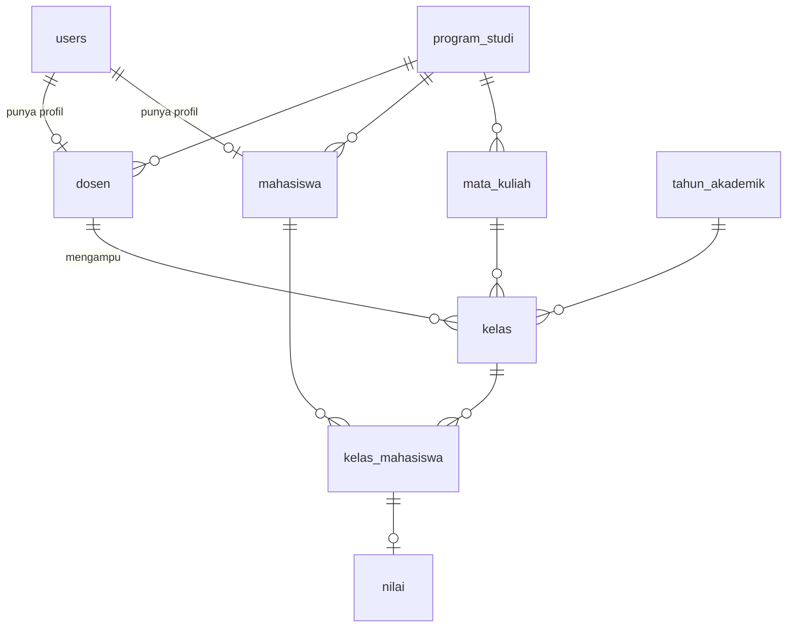

# Implementation Plan — Sistem Pengelolaan Nilai Mahasiswa (SIPENMA) dengan Laravel

> Seluruh sistem dibangun sebagai **satu aplikasi Laravel monolith** (autentikasi, area per role, master data, nilai, dashboard, dan laporan dalam satu codebase). Ganti `[NAMA_KAMPUS]` dengan nama institusi kamu. Dokumen pendamping: `02-prompt.md`.

---

## 1. Tujuan & Ruang Lingkup

**Tujuan bisnis**
- Mengurangi pengelolaan nilai manual dan memusatkan data akademik.
- Mengurangi kesalahan perhitungan nilai lewat perhitungan otomatis.
- Memberi akses informasi nilai yang cepat dan sesuai role.
- Menghasilkan laporan akademik dalam format PDF dan Excel.

**Tiga peran utama**

| Peran | Akses |
|---|---|
| **Admin** | Master data (prodi, tahun akademik, dosen, mahasiswa, mata kuliah, kelas, peserta kelas), pengaturan bobot & grade, lihat semua nilai, dashboard global, laporan & export |
| **Dosen** | Kelas yang diampu, input/edit nilai kelas sendiri, dashboard kelas, laporan & export kelas sendiri |
| **Mahasiswa** | Mata kuliah yang diikuti, nilai/grade/status milik sendiri, laporan milik sendiri (tanpa export) |

**MVP (Versi 1)**
- Login, logout, reset password, redirect per role
- CRUD Program Studi, Dosen, Mahasiswa, Mata Kuliah, Kelas (+ peserta kelas), Tahun Akademik
- Input nilai Kuis, Tugas, UTS, UAS; nilai akhir, grade, status otomatis
- Dashboard per role dengan grafik
- Laporan nilai berfilter + export PDF & Excel
- Testing, optimasi, deployment

**Di luar scope (sesuai PRD)**
- KRS online, presensi, jadwal kuliah, transkrip akademik, pembayaran, notifikasi, integrasi SIAKAD eksternal, aplikasi mobile

**Versi 2 (kandidat)**
- Kunci/finalisasi nilai, audit log perubahan nilai, import nilai dari Excel, komponen nilai dinamis, bobot per mata kuliah, transkrip & IPK, notifikasi email

---

## 2. Asumsi

| Item | Asumsi |
|---|---|
| Pasar | Satu institusi pendidikan di Indonesia (Bahasa Indonesia, zona waktu Asia/Jakarta) |
| Skala data awal | ≤ 50 dosen, ≤ 3.000 mahasiswa, ≤ 300 kelas per tahun akademik |
| Tim | 1 developer (atau AI coding agent) + 1 pemilik proses akademik |
| Akun | Dibuat oleh Admin; **tidak ada registrasi publik** |
| Skala nilai | 0–100 |
| Bobot default | Kuis 10, Tugas 20, UTS 30, UAS 40 (**usulan**, dapat diubah) |
| Grade default | A ≥ 80, B ≥ 70, C ≥ 60, D ≥ 50, E ≥ 0 (**usulan**, dapat diubah) |
| Kelulusan | Grade C ke atas = Lulus (**usulan**, dapat diubah lewat flag `is_lulus`) |
| Peserta kelas | Dikelola Admin (PRD tidak mendefinisikan, ditambahkan tabel `kelas_mahasiswa`) |
| Hosting | VPS / hosting PHP 8.3+ dengan MySQL |
| Trafik | Penggunaan internal, puncak saat periode input & rilis nilai |

> Catatan: bobot, batas grade, dan batas kelulusan **belum ditetapkan di PRD**. Angka di atas hanya default seeder, bukan keputusan akademik.

---

## 3. Tech Stack (Laravel Monolith)

| Lapisan | Teknologi |
|---|---|
| Framework | Laravel 13, PHP sesuai syarat Laravel 13 (verifikasi di awal) |
| Frontend | Blade + Tailwind CSS (Vite) + Alpine.js seperlunya |
| Autentikasi | Laravel Breeze (stack Blade), registrasi dinonaktifkan |
| Role & izin | Kolom `users.role` (PHP backed Enum) + Middleware + Gate + Policy |
| Database | MySQL |
| Grafik | Chart.js |
| Export Excel | `maatwebsite/excel` |
| Export PDF | `barryvdh/laravel-dompdf` |
| Cache | File/database di tahap awal (Redis opsional) |
| Email | Laravel Mail + SMTP (untuk reset password) |
| Testing | Pest (atau PHPUnit): unit + feature |
| Kualitas kode | Laravel Pint (+ Larastan bila kompatibel) |
| Versi kontrol | Git (+ GitHub Actions untuk CI sederhana) |
| Deploy | VPS + Nginx + PHP-FPM + Let's Encrypt |

> Kompatibilitas Breeze, Laravel Excel, dan DomPDF dengan Laravel 13 **wajib diverifikasi di Fase 1**.

---

## 4. Pembagian Area Aplikasi

```
Publik (guest)        → halaman login, lupa & reset password
Semua user (auth)     → /dashboard (konten per role), /profile
Admin (auth + role)   → /admin/*: master data, peserta kelas, pengaturan nilai
Dosen (auth + role)   → /dosen/*: kelas saya, input nilai
Mahasiswa (auth+role) → /mahasiswa/*: nilai saya
Laporan (auth + Gate) → /laporan: lihat (semua role, scope per role), export (admin & dosen)
```

**Matriks hak akses**

| Fitur | Guest | Admin | Dosen | Mahasiswa |
|---|:-:|:-:|:-:|:-:|
| Login / reset password | ✅ | ✅ | ✅ | ✅ |
| Dashboard | – | Global | Kelas sendiri | Data sendiri |
| CRUD master data & peserta kelas | – | ✅ | – | – |
| Pengaturan bobot & skala grade | – | ✅ | – | – |
| Input / edit nilai | – | – | ✅ (kelas diampu) | – |
| Lihat nilai | – | Semua | Kelas sendiri | Milik sendiri |
| Laporan nilai (web) | – | Semua | Kelas sendiri | Milik sendiri |
| Export PDF / Excel | – | ✅ | ✅ (kelas sendiri) | – |

Lapisan proteksi: **Middleware `role`** (gerbang area) → **Gate** (kemampuan umum, mis. `export-laporan`) → **Policy** (kepemilikan data, mis. dosen ↔ kelas).

---

## 5. Daftar Fitur

### 5.1 Autentikasi & Umum

**MVP**
- [ ] Login, logout, reset password, validasi kredensial
- [ ] Redirect ke dashboard sesuai role
- [ ] Route registrasi dinonaktifkan (`/register` → 404)
- [ ] Profil: ubah nama & password
- [ ] Halaman error 403/404/419/500 berbahasa Indonesia
- [ ] Throttle login & reset password

### 5.2 Admin

**MVP**
- [ ] CRUD **Program Studi** (kode, nama)
- [ ] CRUD **Tahun Akademik** (tahun, semester, satu aktif)
- [ ] CRUD **Dosen** (NIDN, nama, prodi) + akun user
- [ ] CRUD **Mahasiswa** (NIM, nama, prodi, angkatan) + akun user
- [ ] CRUD **Mata Kuliah** (kode, nama, SKS, prodi)
- [ ] CRUD **Kelas** (mata kuliah, dosen, tahun akademik, nama kelas, kapasitas) + **kelola peserta kelas**
- [ ] **Pengaturan Nilai**: bobot komponen (total 100) dan skala grade
- [ ] Dashboard global, laporan semua data, export PDF/Excel

### 5.3 Dosen

**MVP**
- [ ] Daftar **kelas yang diampu** (filter tahun akademik)
- [ ] Daftar mahasiswa per kelas
- [ ] **Input & edit nilai** Kuis, Tugas, UTS, UAS (massal per kelas)
- [ ] Nilai akhir, grade, status otomatis
- [ ] Dashboard: kelas, jumlah mahasiswa, ringkasan nilai
- [ ] Laporan kelas sendiri + export PDF/Excel

### 5.4 Mahasiswa

**MVP**
- [ ] Dashboard: mata kuliah, nilai, grade, status
- [ ] Halaman **Nilai Saya** per tahun akademik (read-only)
- [ ] Laporan nilai milik sendiri (tanpa export)

### 5.5 Versi 2

- [ ] Kunci/finalisasi nilai + batas waktu input
- [ ] Audit log perubahan nilai (`updated_by` sudah disiapkan di MVP)
- [ ] Import nilai dari Excel
- [ ] Komponen nilai dinamis dan bobot per mata kuliah
- [ ] Transkrip & IPK (butuh bobot mutu per grade)
- [ ] Notifikasi email saat nilai terbit

---

## 6. Struktur Route (Ringkas)

```
# Auth (Breeze, tanpa register)
GET   /login | /forgot-password | /reset-password/{token}
POST  /logout

# Semua user login
GET   /dashboard                        konten per role
GET   /profile

# Admin (middleware: auth, role:admin)
resource /admin/program-studi
resource /admin/tahun-akademik          + PATCH /{id}/aktifkan
resource /admin/dosen
resource /admin/mahasiswa
resource /admin/mata-kuliah
resource /admin/kelas
GET|POST|DELETE /admin/kelas/{kelas}/peserta
GET|PUT /admin/pengaturan-nilai

# Dosen (middleware: auth, role:dosen)
GET   /dosen/kelas                      kelas saya
GET   /dosen/kelas/{kelas}              peserta & nilai
GET   /dosen/kelas/{kelas}/nilai        form input massal
PUT   /dosen/kelas/{kelas}/nilai        simpan (Policy: kelas diampu)

# Mahasiswa (middleware: auth, role:mahasiswa)
GET   /mahasiswa/nilai                  nilai saya

# Laporan (middleware: auth; scope per role di service)
GET   /laporan                          tampil + filter
GET   /laporan/export/pdf               Gate: export-laporan
GET   /laporan/export/excel             Gate: export-laporan
```

---

## 7. Model Data & Migrasi

**ERD**



| Tabel / Model | Kolom utama | Constraint / Index |
|---|---|---|
| `users` | id, name, email, password, **role** (`admin`/`dosen`/`mahasiswa`), remember_token | unique(email), index(role) |
| `program_studi` | id, kode, nama, deleted_at | unique(kode) |
| `dosen` | id, user_id (nullable), nidn, nama, program_studi_id, deleted_at | unique(nidn), unique(user_id) |
| `mahasiswa` | id, user_id (nullable), nim, nama, program_studi_id, angkatan, deleted_at | unique(nim), unique(user_id), index(angkatan) |
| `mata_kuliah` | id, kode, nama, sks, program_studi_id, deleted_at | unique(kode) |
| `tahun_akademik` | id, tahun (mis. `2025/2026`), semester (`ganjil`/`genap`), is_active | unique(tahun, semester) |
| `kelas` | id, mata_kuliah_id, dosen_id, tahun_akademik_id, nama_kelas, kapasitas (nullable) | unique(mata_kuliah_id, tahun_akademik_id, nama_kelas), index(dosen_id) |
| `kelas_mahasiswa` | id, kelas_id, mahasiswa_id | unique(kelas_id, mahasiswa_id), index(mahasiswa_id) |
| `nilai` | id, kelas_mahasiswa_id, kuis, tugas, uts, uas, nilai_akhir, grade, status, updated_by | unique(kelas_mahasiswa_id), index(grade), index(status) |
| `pengaturan_nilai` | id, komponen (`kuis`/`tugas`/`uts`/`uas`), bobot | unique(komponen); total = 100 |
| `skala_grade` | id, grade, nilai_min, is_lulus, urutan | unique(grade) |

Catatan desain:
- Semua FK memakai `restrictOnDelete()` (kecuali `nilai` → `kelas_mahasiswa`); data master memakai SoftDeletes.
- `nilai.kuis/tugas/uts/uas` = `decimal(5,2) nullable`; `nilai_akhir` = `decimal(5,2) nullable`.
- Komponen nilai dibuat 4 kolom (sesuai PRD, sederhana). Jika kelak butuh komponen dinamis, migrasikan ke `komponen_nilai` + `nilai_detail`.
- Bobot & skala grade di-cache dan cache dibersihkan saat diubah.

---

## 8. Struktur Kode

```
app/
  Enums/                 Role, StatusNilai, Semester
  Models/                User, ProgramStudi, Dosen, Mahasiswa, MataKuliah, TahunAkademik,
                         Kelas, KelasMahasiswa, Nilai, PengaturanNilai, SkalaGrade
  Http/
    Controllers/
      Admin/             ProgramStudi, TahunAkademik, Dosen, Mahasiswa, MataKuliah, Kelas, PesertaKelas, PengaturanNilai
      Dosen/             KelasSaya, Nilai
      Mahasiswa/         NilaiSaya
      DashboardController, LaporanController
    Middleware/          EnsureUserHasRole (alias: role)
    Requests/            Store/Update per resource, NilaiRequest
  Policies/              KelasPolicy, NilaiPolicy, MahasiswaPolicy
  Services/              NilaiCalculator, DashboardService, LaporanService, PengaturanNilaiService
  Exports/               LaporanNilaiExport
  Console/Commands/      RecalculateNilai (nilai:recalculate)
resources/views/         layouts, components (x-chart, badge), admin, dosen, mahasiswa, dashboard, laporan, pdf
routes/                  web.php, auth.php
database/                migrations, factories, seeders
tests/                   Feature/, Unit/
docs/                    erd.md, schema.md, deployment.md, user-guide.md
```

Prinsip: controller tipis → **Form Request** untuk validasi → **Service** untuk logika bisnis → **Policy** untuk kepemilikan data → Eloquent dengan eager loading + pagination.

---

## 9. Alur Utama & Aturan Bisnis

**Rumus nilai akhir**

```
Nilai Akhir = (Kuis × bobot_kuis + Tugas × bobot_tugas + UTS × bobot_uts + UAS × bobot_uas) / 100
```

**Aturan**
1. Semua komponen 0–100, maksimal 2 desimal; total bobot wajib 100.
2. Ada komponen kosong → `nilai_akhir` & `grade` = null, status = `belum_lengkap`.
3. Pembulatan 2 desimal (half up).
4. Grade = grade dengan `nilai_min` tertinggi yang ≤ nilai akhir; status dari `is_lulus`.
5. Logika hanya ada di `NilaiCalculator` (murni, mudah di-unit-test).

**Default seeder (usulan)**

| Komponen | Bobot | | Grade | Nilai min | Lulus |
|---|---:|---|---|---:|:-:|
| Kuis | 10 | | A | 80 | ✅ |
| Tugas | 20 | | B | 70 | ✅ |
| UTS | 30 | | C | 60 | ✅ |
| UAS | 40 | | D | 50 | – |
| **Total** | **100** | | E | 0 | – |

**Alur input nilai**
1. Admin membuat kelas dan menambahkan peserta.
2. Dosen membuka *Kelas Saya* → pilih kelas → form nilai massal.
3. Dosen mengisi Kuis/Tugas/UTS/UAS → simpan.
4. Server memvalidasi, menghitung ulang nilai akhir/grade/status, menyimpan dalam transaction.
5. Mahasiswa melihat hasilnya di *Nilai Saya*; admin & dosen melihatnya di laporan.

**Alur laporan**
1. User memilih filter (mahasiswa, mata kuliah, kelas, dosen, prodi, semester).
2. `LaporanService` menerapkan scope per role, lalu filter.
3. Tampil di web (paginate); admin/dosen dapat export PDF/Excel dengan query yang sama.

**Perubahan bobot/skala:** admin mengubah pengaturan → sistem menampilkan peringatan → jalankan `nilai:recalculate` (`--dry-run` untuk pratinjau) agar nilai lama konsisten.

**Pembuatan akun:** Admin membuat Dosen/Mahasiswa → User + profil dibuat dalam satu transaction → akun dapat login dan mengganti password.

---

## 10. Desain & UI

- Antarmuka akademik yang bersih dan profesional; konsisten dengan Tailwind (design tokens: warna, spacing, tipografi)
- Layout dengan sidebar/navbar; menu menyesuaikan role
- Tabel dengan pencarian, filter, pagination; flash message; konfirmasi hapus
- Badge warna untuk grade dan status (Lulus / Tidak Lulus / Belum Lengkap)
- Form input nilai: grid angka yang nyaman di desktop dan HP; pratinjau nilai akhir di klien (nilai resmi tetap dari server)
- Dashboard: kartu statistik + grafik Chart.js (distribusi grade, rata-rata per mata kuliah)
- Empty state dan pesan error ramah, Bahasa Indonesia
- Aksesibilitas dasar: label form, kontras warna, navigasi keyboard

---

## 11. Fase & Timeline (Estimasi)

| Fase | Durasi | Output |
|---|---|---|
| **0. Persiapan** | Minggu 1 | Keputusan bobot & grade, daftar prodi/mata kuliah, akses server |
| **1. Persiapan teknis** | Minggu 1 | Laravel 13, Breeze, Tailwind, Excel, DomPDF, Chart.js |
| **2. Database** | Minggu 1 | ERD & schema disetujui |
| **3. Migration** | Minggu 1–2 | Struktur database |
| **4. Model & relasi** | Minggu 2 | Enum, model, factory |
| **5. Seeder** | Minggu 2 | Data awal + bobot/grade default |
| **6. Authentication** | Minggu 2–3 | Login/logout/reset, redirect role |
| **7. Authorization** | Minggu 3 | Middleware, Gate, Policy, test akses |
| **8. Dashboard** | Minggu 3–4 | Dashboard per role + grafik |
| **9. Master data** | Minggu 4–5 | CRUD akademik, peserta kelas, pengaturan nilai |
| **10. Modul nilai** | Minggu 5–6 | Input nilai, kalkulator, Nilai Saya, recalculate |
| **11. Laporan** | Minggu 6–7 | Laporan berfilter, export PDF & Excel |
| **12. Testing & deployment** | Minggu 7–8 | Test lengkap, optimasi, deploy, UAT |
| **13. Pasca-launch** | Minggu 9+ | Iterasi & fitur versi 2 |

---

## 12. Keamanan

- HTTPS, `APP_DEBUG=false` di produksi, `APP_KEY` dan semua secret di `.env`
- Password hashing bawaan Laravel, throttle login & reset password
- Registrasi publik dinonaktifkan; akun hanya dibuat Admin
- Otorisasi berlapis (Middleware → Gate → Policy); cegah **IDOR** pada semua route model binding
- Dosen hanya kelas yang diampu; mahasiswa hanya data sendiri; admin tidak menginput nilai
- Validasi lewat Form Request; `$fillable` untuk mass assignment; output Blade `{{ }}` (anti-XSS); CSRF aktif
- Scope data laporan diterapkan di server, bukan hanya di UI; export dilindungi Gate
- Akun demo hanya di environment `local`/`testing`; ganti password admin awal di produksi
- Backup database terjadwal, uji restore
- Log error; jangan menampilkan stack trace ke user

---

## 13. Performa & Optimasi

- Index pada kolom filter: `grade`, `status`, `angkatan`, `dosen_id`, FK
- Eager loading pada semua daftar dan laporan; pagination (mis. 15 baris)
- Query agregat untuk dashboard (bukan hitung di PHP); cache singkat statistik admin
- Cache `pengaturan_nilai` dan `skala_grade` (clear saat diubah)
- Export besar memakai chunk/cursor
- `config:cache`, `route:cache`, `view:cache`, `event:cache` di produksi
- Deteksi N+1 selama pengembangan (`DB::listen`/Debugbar) dan assert jumlah query pada test halaman utama

---

## 14. Testing & QA

**Otomatis (Pest/PHPUnit)**
- [ ] Unit: `NilaiCalculator` (batas grade 49.99/50/59.99/60/79.99/80/100, komponen null, pembulatan, bobot custom)
- [ ] Feature: login/logout/reset password, `/register` 404, redirect per role
- [ ] Feature: matriks role × endpoint; dosen A tidak bisa ubah nilai kelas dosen B; mahasiswa tidak bisa lihat nilai mahasiswa lain
- [ ] Feature: CRUD master data + validasi + hapus data terpakai ditolak
- [ ] Feature: input nilai (valid, di luar 0–100 ditolak, hanya dosen pengampu)
- [ ] Feature: laporan per role, filter, manipulasi parameter (IDOR), export PDF/Excel, mahasiswa export 403
- [ ] Command `nilai:recalculate` (termasuk `--dry-run`)

**Manual / UAT**
- [ ] Alur lengkap admin → dosen → mahasiswa dengan data nyata sampel
- [ ] Responsif di HP dan desktop
- [ ] Angka dashboard, laporan web, PDF, dan Excel konsisten untuk filter yang sama
- [ ] Pemilik proses akademik memverifikasi hasil perhitungan nilai & grade

---

## 15. Deployment

1. Server: Ubuntu + Nginx + PHP-FPM 8.3+ + MySQL
2. `composer install --no-dev --optimize-autoloader`, `npm ci && npm run build`
3. `.env` produksi (`APP_ENV=production`, `APP_DEBUG=false`, DB, SMTP), `php artisan key:generate`
4. `php artisan migrate --force`; seed hanya `PengaturanNilaiSeeder`, `SkalaGradeSeeder`, dan akun admin awal
5. `php artisan config:cache route:cache view:cache event:cache`, `storage:link`
6. Permission `storage/` & `bootstrap/cache/`; SSL (Let's Encrypt); firewall
7. Backup database otomatis + uji restore; monitoring log
8. CI: Pint + test sebelum deploy; alur Git → staging → produksi

---

## 16. Rencana Go-Live

1. Keputusan bobot, grade, dan kelulusan disahkan pemilik proses akademik
2. Import/isi data master awal (prodi, mata kuliah, dosen, mahasiswa)
3. UAT di staging oleh admin, 1–2 dosen, dan beberapa mahasiswa
4. Ganti password admin awal; pastikan tidak ada akun demo
5. Pilot di satu prodi / satu semester sebelum rollout penuh
6. Pantau error dan umpan balik di minggu pertama

---

## 17. Biaya (Komponen)

| Komponen | Sifat |
|---|---|
| Domain | Tahunan |
| VPS/hosting + database | Bulanan |
| SSL | Gratis (Let's Encrypt) |
| Layanan email SMTP | Gratis–berbayar sesuai volume |
| Pengembangan & pemeliharaan | Sekali + berkala |

> Laravel, Breeze, Laravel Excel, DomPDF, dan Chart.js bersifat open source; tidak ada biaya lisensi platform.

---

## 18. Risiko & Mitigasi

| Risiko | Mitigasi |
|---|---|
| Bobot/grade belum diputuskan | Dibuat configurable + default seeder; keputusan dikunci sebelum UAT |
| Paket belum kompatibel dengan Laravel 13 | Verifikasi di Fase 1; siapkan alternatif/pin versi |
| Dosen mengubah/melihat nilai kelas lain (IDOR) | Policy + test lintas-dosen |
| Perubahan bobot membuat nilai lama tidak konsisten | Snapshot + `nilai:recalculate` dengan `--dry-run` |
| Nilai belum lengkap terbaca sebagai nilai akhir | Status `belum_lengkap`, nilai akhir null |
| Data yatim saat hapus master | `restrictOnDelete`, SoftDeletes, pesan penolakan ramah |
| Lonjakan akses saat rilis nilai | Cache, index, pagination, query agregat |
| Akun demo bocor ke produksi | Seeder demo hanya `local`/`testing`; checklist go-live |
| Scope creep (KRS, jadwal, transkrip) | Daftar "di luar scope" di PRD dan master prompt |

---

## 19. Definition of Done (MVP)

- [ ] Admin, dosen, dan mahasiswa dapat login dan diarahkan ke dashboard sesuai role
- [ ] Admin dapat mengelola seluruh master data dan peserta kelas
- [ ] Dosen dapat input/edit empat komponen nilai hanya untuk kelas yang diampu
- [ ] Nilai akhir, grade, dan status dihitung otomatis dari bobot & skala di database
- [ ] Mahasiswa hanya melihat data miliknya
- [ ] Dashboard per role menampilkan data yang benar
- [ ] Laporan berfilter tampil sesuai scope role; export PDF & Excel (admin/dosen) konsisten dengan tampilan web
- [ ] Test otorisasi, perhitungan nilai, dan laporan lulus; Pint bersih
- [ ] Tidak ada N+1 pada halaman utama
- [ ] Deployment, backup, dan dokumentasi (README, deployment, user guide) tersedia

---

## 20. Langkah Berikutnya

1. Putuskan bobot komponen, batas grade, dan batas kelulusan
2. Siapkan data awal: program studi, mata kuliah, dosen, mahasiswa
3. Siapkan server/hosting, domain, dan SMTP
4. Jalankan `sipenma-prompt.md` fase demi fase bersama AI coding agent
5. Review tiap fase (test, acceptance, commit) sebelum lanjut