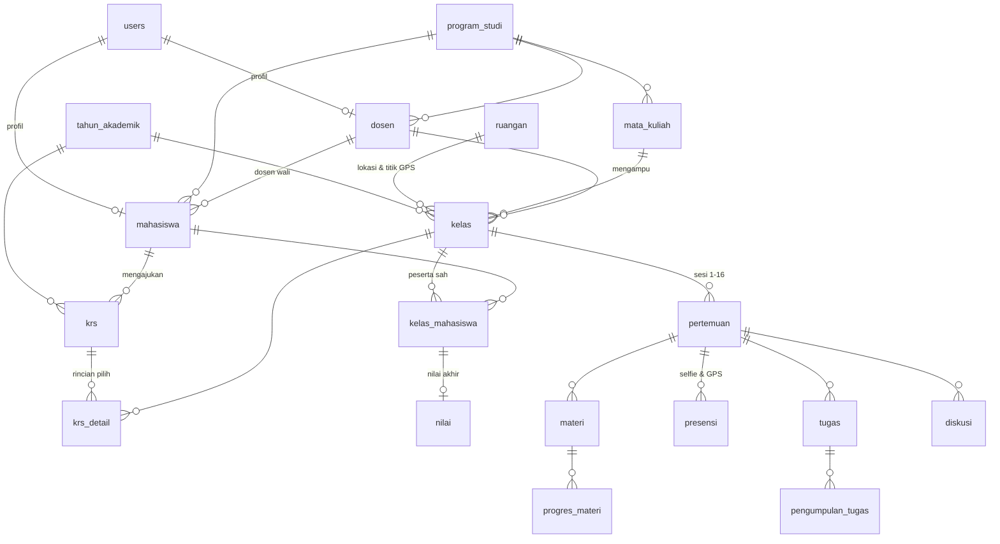

# Implementation Plan — Sistem Akademik & E-Learning Hybrid Mahasiswa (SIELMA) dengan Laravel

> Seluruh sistem dibangun sebagai **satu aplikasi Laravel 13 monolith** yang menggabungkan modul akademik inti (**KRS Online, Penjadwalan Kelas Offline/Online, & Pengelolaan Nilai**) dengan **E-Learning / LMS** (materi pertemuan, pengumpulan tugas, **presensi berbasis Foto Selfie & GPS Geofencing**, dan diskusi) dalam satu codebase. Ganti `Universitas Merdeka` dengan nama institusi kamu. Dokumen pendamping: `02-prompt.md`.

---

## 1. Tujuan & Ruang Lingkup

**Tujuan bisnis**
- Mengintegrasikan alur akademik mulai dari pengisian **Kartu Rencana Studi (KRS)**, perkuliahan **Offline (Tatap Muka) & Online (Blended Learning)**, hingga penilaian akhir dalam satu sistem terpadu.
- Mencegah bentrok jadwal kuliah, kelebihan kuota ruangan/kelas, dan pelanggaran batas SKS melalui validasi otomatis saat pengisian KRS.
- Mencegah kecurangan titip absen ("TA") melalui **Presensi Terverifikasi** yang menggabungkan tangkapan layar kamera langsung (**Foto Selfie Live**), pencatatan koordinat **GPS (Latitude/Longitude)**, perhitungan jarak radius (**Geofencing** terhadap titik koordinat ruangan/kampus untuk kelas *offline*), dan opsional **Kode PIN Sesi**.
- Mengotomatiskan rekapitulasi nilai tugas *e-learning* dan komponen evaluasi (Kuis, Tugas, UTS, UAS) menjadi nilai akhir, *grade*, dan status kelulusan.
- Menyediakan cetak kartu/laporan resmi dalam format PDF dan Excel (Lembar KRS, Daftar Hadir + Bukti Presensi, dan Laporan Nilai).

**Tiga peran utama**

| Peran | Cakupan Akses Utama |
|---|---|
| **Admin** | Master data (prodi, ruangan + koordinat GPS & radius, tahun akademik & periode KRS, dosen, mahasiswa + dosen wali, MK, kelas & jadwal), override KRS, pengaturan bobot & grade, laporan global |
| **Dosen** | **Dosen Pengampu**: kelola pertemuan (offline/online), materi, verifikasi presensi (cek foto selfie & lokasi GPS mahasiswa), tugas, diskusi, input nilai. **Dosen Wali (PA)**: tinjau & setujui/tolak KRS mahasiswa bimbingan |
| **Mahasiswa** | Isi & ajukan KRS online, cetak PDF KRS, lihat jadwal kuliah (offline/online), akses materi, **isi presensi dengan foto selfie kamera & lokasi GPS**, unggah tugas, diskusi, lihat nilai & KHS semester |

**MVP (Versi 1)**
- Login, logout, reset password, redirect otomatis per role
- CRUD Master Data: Program Studi, **Ruangan (dilengkapi titik koordinat GPS `latitude`, `longitude`, & `radius_meter`)**, Tahun Akademik (+ buka/tutup periode KRS), Dosen, Mahasiswa (+ plotting Dosen Wali), Mata Kuliah (semester paket & SKS)
- CRUD **Kelas Perkuliahan** (tipe: `offline` / `online` / `hybrid`, ruangan, hari, jam mulai–selesai, kapasitas kuota)
- **Modul KRS Online**: pilih kelas oleh mahasiswa, validasi batas SKS, deteksi bentrok jadwal & kuota kelas, persetujuan (*approval*) oleh Dosen Wali, serta cetak PDF KRS
- **Manajemen Pertemuan (Sesi 1–16)**: mendukung mode *Tatap Muka (Offline)* di ruangan fisik maupun *Daring (Online)* lewat tautan video conference, dilengkapi Berita Acara Perkuliahan (BAP)
- **Materi Ajar & Progres**: unggah file/link/video oleh dosen & penanda selesai belajar oleh mahasiswa
- **Presensi Berbasis Foto Selfie & GPS (Offline & Online)**:
  - Pengambilan foto selfie langsung dari kamera perangkat (`navigator.mediaDevices.getUserMedia` — tanpa unggah dari galeri untuk mencegah foto lama) dan pembacaan koordinat GPS (`navigator.geolocation`).
  - Perhitungan jarak otomatis di server menggunakan rumus **Haversine** terhadap koordinat ruangan/kampus.
  - Untuk pertemuan **Offline**: validasi jarak dalam radius ruangan (mis. $\le 100$ meter) + foto selfie + opsional Kode PIN.
  - Untuk pertemuan **Online**: wajib foto selfie + pencatatan titik lokasi GPS mahasiswa saat mengikuti kelas daring.
  - Fitur tinjau bukti foto selfie & peta lokasi oleh dosen (serta input/koreksi manual oleh dosen bila perangkat mahasiswa bermasalah).
- **Tugas (*Assignment*) & Penilaian**: pembuatan tugas berbatas waktu (*deadline*), unggah file *submission* oleh mahasiswa, penilaian & *feedback* oleh dosen
- **Pengelolaan Nilai Akhir**: sinkronisasi rata-rata nilai tugas ke rekap nilai akhir, input Kuis/UTS/UAS, kalkulasi otomatis Nilai Akhir, *Grade*, dan Status Kelulusan
- Dashboard per role + Laporan Akademik (KRS, Presensi, Nilai) & Export PDF/Excel

**Di luar scope (MVP)**
- Biometrik pengenalan wajah otomatis berbasis AI (*Face Recognition* / *Liveness Detection* 3D — MVP menggunakan verifikasi visual foto selfie oleh dosen), pembayaran UKT/SPP & *payment gateway*, integrasi Neo Feeder PDDIKTI, video conference internal WebRTC, dan ujian CBT ber-*timer*.

**Versi 2 (kandidat)**
- Validasi wajah otomatis (*Face Matching*) membandingkan foto selfie presensi dengan foto profil KTM mahasiswa
- Perhitungan IPS/IPK otomatis & penentuan batas SKS KRS dinamis berdasarkan IPS semester lalu
- Masa Batal-Tambah (*Add/Drop*) KRS mandiri & prasyarat mata kuliah (*prerequisite*)
- Modul Kuis/Ujian CBT interaktif & notifikasi WhatsApp/Email

---

## 2. Asumsi

| Item | Asumsi |
|---|---|
| Pasar | Institusi pendidikan tinggi di Indonesia (Bahasa Indonesia, zona waktu `Asia/Jakarta`) |
| Skala data awal | Maks. 50 dosen, 3.000 mahasiswa, 300 kelas per semester, 14–16 pertemuan per kelas |
| Akun pengguna | Dibuat oleh Admin; **tidak ada registrasi publik** |
| Protokol Keamanan | **Wajib HTTPS** (di lokal via Laragon SSL / `localhost`, di produksi via Let's Encrypt) karena API Kamera (`getUserMedia`) & GPS (`Geolocation`) di browser modern hanya berjalan di konteks aman (*secure context*) |
| Aturan KRS | Mahasiswa hanya dapat mengisi KRS saat `is_krs_open = true` pada tahun akademik aktif; batas default maks. 24 SKS |
| Persetujuan KRS | Mahasiswa baru masuk ke daftar peserta kelas (`kelas_mahasiswa`) setelah KRS **Disetujui** Dosen Wali/Admin |
| Aturan GPS & Selfie | Foto selfie dikompresi di sisi klien via `<canvas>` (maks. resolusi $640 \times 480$ px, JPEG kualitas $0.75$, ukuran $\approx 40\text{–}80\text{ KB}$) sebelum dikirim ke server agar hemat disk & cepat diunggah. Toleransi akurasi GPS perangkat ditetapkan maks. $150\text{ meter}$ |
| Radius Geofencing | Default radius ruangan/gedung kampus adalah $50\text{–}100\text{ meter}$ (dapat diatur per ruangan; dosen dapat memilih menolak otomatis atau menandai `di_luar_radius` jika melebihi batas) |
| Penyimpanan File | Disk `private` Laravel untuk materi, *submission* tugas, dan **foto selfie presensi** |
| Bobot & Grade | Kuis 10, Tugas 20, UTS 30, UAS 40; Grade A $\ge 80$, B $\ge 70$, C $\ge 60$, D $\ge 50$, E $\ge 0$ (Lulus min. C) |

---

## 3. Tech Stack (Laravel Monolith)

| Lapisan | Teknologi |
|---|---|
| Framework | Laravel 13, PHP 8.3+ |
| Frontend | Blade + Tailwind CSS v4 (Vite) + Alpine.js (komponen kamera live, kompresi canvas, & pembacaan GPS) |
| Peta Lokasi (Opsional UI) | Tautan langsung Google Maps (`https://www.google.com/maps?q=lat,lng`) atau Leaflet.js + OpenStreetMap (gratis, tanpa API key berbayar) untuk pratinjau titik presensi |
| Autentikasi | Laravel Breeze (Blade), registrasi publik dinonaktifkan |
| Otorisasi | Kolom `users.role` (PHP Backed Enum) + Middleware + Gate + Policy |
| Database | MySQL / MariaDB (InnoDB dengan `lockForUpdate()` untuk kuota KRS) |
| File Storage | Laravel Filesystem (`Storage::disk('private')` dengan *stream controller* terproteksi Policy) |
| Grafik | Chart.js |
| Export PDF & Excel | `barryvdh/laravel-dompdf` (Cetak KRS, Daftar Hadir, Laporan Nilai) & `maatwebsite/excel` |
| Testing & Kualitas | Pest / PHPUnit + Laravel Pint |
| Deployment | VPS Linux (Debian/Ubuntu) + Nginx + PHP-FPM 8.3 + SSL Let's Encrypt |

---

## 4. Pembagian Area Aplikasi

```
Publik (guest)        -> /login, /forgot-password, /reset-password
Semua user (auth)     -> /dashboard, /profile, /jadwal, /pertemuan/{id}/diskusi
File Aman (auth+Pol)  -> /unduh/materi/{materi}, /unduh/pengumpulan/{pengumpulan}, /presensi/{presensi}/foto
Admin (auth + role)   -> /admin/*: master data, ruangan (+GPS), kelas & jadwal, pantau KRS, pengaturan nilai
Dosen (auth + role)   -> /dosen/perwalian/* (validasi KRS), /dosen/kelas/* (materi, presensi+cek selfie/GPS, tugas, nilai)
Mahasiswa (auth+role) -> /mahasiswa/krs/* (isi & cetak KRS), /mahasiswa/kelas/* (belajar, presensi selfie+GPS), /mahasiswa/nilai
Laporan (auth + Gate) -> /laporan: rekap nilai & kehadiran (web), export PDF/Excel (Admin & Dosen)
```

**Matriks hak akses**

| Fitur | Admin | Dosen | Mahasiswa |
|---|:-:|:-:|:-:|
| Master data (Prodi, Ruangan + Titik GPS, MK, Tahun Akademik, User) | ✅ | – | – |
| Buat kelas, jadwal, ruangan, & kapasitas kuota | ✅ | – | Lihat saat KRS |
| Pengajuan KRS & Cetak PDF KRS | Override | – | ✅ (periode aktif) |
| Persetujuan (*Approval*) KRS Mahasiswa | ✅ (Override) | ✅ (Mahasiswa wali) | – |
| Kelola pertemuan (Offline/Online), BAP, & Materi | Pantau | ✅ (Kelas diampu) | Akses & Tandai selesai |
| Isi presensi mandiri dengan **Foto Selfie & GPS** | – | – | ✅ (Saat sesi dibuka) |
| Lihat foto selfie presensi, titik GPS, & jarak mahasiswa | ✅ | ✅ (Kelas diampu) | ✅ (Milik sendiri) |
| Override/input manual status presensi (Izin/Sakit/Hadir) | – | ✅ (Kelas diampu) | – |
| Buat tugas (*assignment*) & nilai *submission* | Pantau | ✅ (Kelas diampu) | Unggah jawaban |
| Input nilai Kuis/Tugas/UTS/UAS & Sinkronisasi | Lihat semua | ✅ (Kelas diampu) | Lihat milik sendiri |
| Laporan akademik & Export PDF / Excel | ✅ (Semua) | ✅ (Kelas sendiri) | Lihat web & cetak KRS |

---

## 5. Daftar Fitur

### 5.1 Autentikasi & Umum (MVP)
- [ ] Login, logout, reset password, *rate limiting*, dan redirect ke dashboard sesuai role
- [ ] Penonaktifan route `/register` (404) dan halaman error kustom berbahasa Indonesia
- [ ] Halaman **Jadwal Kuliah Mingguan** (menampilkan waktu, mata kuliah, mode offline/online, dan ruangan beserta lokasi gedung)

### 5.2 Admin (MVP)
- [ ] CRUD **Program Studi** (kode, nama)
- [ ] CRUD **Ruangan & Lokasi Geofencing**: kode, nama ruangan, gedung, kapasitas, tipe (`kelas`/`lab`/`auditorium`), **`latitude`**, **`longitude`**, dan **`radius_meter`** (dilengkapi tombol *"Ambil Lokasi Saat Ini"* atau pilih titik di peta)
- [ ] CRUD **Tahun Akademik** (tahun, semester, `is_active`, periode mulai–selesai KRS, sakelar `is_krs_open`, `maks_sks_default`)
- [ ] CRUD **Dosen** (NIDN, nama, prodi) + akun user otomatis
- [ ] CRUD **Mahasiswa** (NIM, nama, prodi, angkatan, **dosen wali**) + akun user otomatis
- [ ] CRUD **Mata Kuliah** (kode, nama, SKS, semester paket, prodi)
- [ ] CRUD **Kelas & Jadwal** (mata kuliah, dosen pengampu, tahun akademik, nama kelas, tipe `offline`/`online`/`hybrid`, ruangan, hari, jam mulai, jam selesai, kapasitas kuota) + deteksi bentrok ruangan/dosen
- [ ] **Manajemen Peserta Kelas & Override KRS**: pantau status KRS seluruh mahasiswa, bantu setujui/batal-tambah paksa bila diperlukan
- [ ] **Pengaturan Nilai**: konfigurasi bobot komponen (Kuis, Tugas, UTS, UAS) dan skala *grade*
- [ ] Dashboard global, laporan akademik lengkap, serta export PDF & Excel

### 5.3 Dosen — Sebagai Dosen Wali & Dosen Pengampu (MVP)
- [ ] **Perwalian KRS (Dosen Wali)**: daftar mahasiswa bimbingan, periksa daftar kelas yang diajukan di KRS, berikan catatan pembimbing, lalu klik **Setujui KRS** atau **Minta Revisi**
- [ ] **Manajemen Pertemuan (Dosen Pengampu)**: kelola Sesi 1–16, tentukan mode (`offline` di ruangan kampus atau `online` via link Zoom/GMeet), serta isi **Berita Acara Perkuliahan (BAP)**
- [ ] **Materi Ajar**: unggah dokumen PDF/PPTX, tautan luar, atau video per pertemuan + lihat rekap progres baca mahasiswa
- [ ] **Manajemen & Verifikasi Presensi (Selfie + GPS + Manual)**:
  - Pengaturan sesi presensi: buka/tutup sesi, aktifkan/nonaktifkan kewajiban **Selfie Kamera**, validasi **Radius GPS**, serta opsional **Kode PIN 6 digit**.
  - **Galeri Verifikasi Presensi**: melihat *thumbnail* foto selfie mahasiswa, jarak dalam satuan meter dari ruangan (badge hijau `Dalam Radius: 18m` atau kuning/merah `Luar Radius: 240m`), tautan titik Google Maps, dan tombol pembatalan/koreksi status jika foto selfie tidak valid.
  - **Input Manual oleh Dosen**: mengubah status mahasiswa menjadi `izin`, `sakit`, `alpha`, atau `hadir` manual (misal bila HP mahasiswa mati di kelas tatap muka).
- [ ] **Tugas & Penilaian**: buat tugas dengan *deadline*, unduh jawaban mahasiswa, beri skor (0–100) & *feedback*
- [ ] **Rekap Nilai Akhir**: sinkronkan rata-rata nilai tugas e-learning ke kolom Tugas, input nilai Kuis/UTS/UAS secara massal, hitung nilai akhir & *grade* otomatis
- [ ] Dashboard dosen, cetak daftar hadir, serta export laporan nilai kelas (PDF & Excel)

### 5.4 Mahasiswa (MVP)
- [ ] **Pengisian KRS Online**:
  - Pilih kelas pada semester aktif dengan validasi otomatis (batas SKS, mata kuliah unik, kuota kelas, dan deteksi anti-bentrok jadwal hari/jam).
  - Ajukan KRS ke Dosen Wali, pantau status (`Draft` $\rightarrow$ `Diajukan` $\rightarrow$ `Revisi` / `Disetujui`), dan **Cetak Kartu Rencana Studi (PDF)** setelah disetujui.
- [ ] **Jadwal & Ruang Kelas**: lihat jadwal kuliah tatap muka maupun daring; akses materi pertemuan dan tandai selesai dipelajari
- [ ] **Presensi Mandiri dengan Foto Selfie & GPS**:
  - Antarmuka pratinjau kamera depan langsung (*live camera viewfinder*) dan indikator status sinyal GPS (menampilkan jarak *real-time* mahasiswa ke ruangan kelas bila mode *offline*).
  - Mengambil swafoto (*capture selfie*) ke `<canvas>`, melampirkan koordinat `latitude`, `longitude`, dan `akurasi_meter` secara otomatis, serta mengirimkan presensi.
  - Untuk permohonan **Izin / Sakit**, mahasiswa dapat memilih status `izin`/`sakit`, memberikan keterangan, dan mengambil foto surat keterangan/bukti pendukung.
- [ ] **Pengumpulan Tugas & Diskusi**: unggah file tugas sebelum *deadline*, lihat nilai/*feedback* dosen, dan berdiskusi di kolom komentar pertemuan
- [ ] **Nilai & KHS Semester**: lihat rincian nilai komponen, nilai akhir, *grade*, dan status lulus per semester

---

## 6. Struktur Route (Ringkas)

```
# Auth & Umum
GET   /login | /forgot-password | /reset-password/{token}
POST  /logout
GET   /dashboard | /profile | /jadwal
POST  /pertemuan/{pertemuan}/diskusi
GET   /unduh/materi/{materi} | /unduh/pengumpulan/{pengumpulan}
GET   /presensi/{presensi}/foto                            stream foto selfie presensi (Policy: pemilik / dosen / admin)

# Admin (middleware: auth, role:admin)
resource /admin/program-studi | /admin/ruangan | /admin/mata-kuliah
resource /admin/tahun-akademik                             + PATCH /{id}/aktifkan + PATCH /{id}/toggle-krs
resource /admin/dosen | /admin/mahasiswa
resource /admin/kelas
GET|POST|DELETE /admin/kelas/{kelas}/peserta               override peserta / KRS
GET|PUT /admin/pengaturan-nilai

# Dosen - Perwalian KRS (middleware: auth, role:dosen; Policy: dosen wali)
GET   /dosen/perwalian                                     daftar mahasiswa bimbingan & status KRS
GET   /dosen/perwalian/krs/{krs}                           detail pengajuan KRS mahasiswa
PATCH /dosen/perwalian/krs/{krs}/setujui                   setujui KRS & sinkron ke kelas_mahasiswa
PATCH /dosen/perwalian/krs/{krs}/revisi                    kembalikan KRS untuk direvisi + catatan

# Dosen - Perkuliahan & E-Learning (middleware: auth, role:dosen; Policy: dosen pengampu)
GET   /dosen/kelas | /dosen/kelas/{kelas}
resource /dosen/kelas/{kelas}/pertemuan
resource /dosen/pertemuan/{pertemuan}/materi
PATCH /dosen/pertemuan/{pertemuan}/presensi/toggle         buka/tutup sesi + opsi wajib GPS/Selfie/PIN
PUT   /dosen/pertemuan/{pertemuan}/presensi                input/ubah presensi manual & verifikasi foto oleh dosen
resource /dosen/pertemuan/{pertemuan}/tugas
GET   /dosen/tugas/{tugas}/pengumpulan
PUT   /dosen/pengumpulan/{pengumpulan}/nilai
GET|PUT /dosen/kelas/{kelas}/nilai                         input nilai akhir massal
POST  /dosen/kelas/{kelas}/nilai/sinkron-tugas             tarik rata-rata nilai tugas ke rekap

# Mahasiswa (middleware: auth, role:mahasiswa)
GET   /mahasiswa/krs                                       halaman pengisian & status KRS
POST  /mahasiswa/krs/tambah-kelas                          pilih kelas (validasi SKS, kuota, bentrok)
DELETE /mahasiswa/krs/hapus-kelas/{krsDetail}              batalkan pilihan kelas (saat draft/revisi)
POST  /mahasiswa/krs/ajukan                                kirim KRS ke Dosen Wali
GET   /mahasiswa/krs/cetak-pdf                             unduh PDF KRS resmi (jika disetujui)
GET   /mahasiswa/kelas | /mahasiswa/kelas/{kelas}
GET   /mahasiswa/kelas/{kelas}/pertemuan/{pertemuan}
POST  /mahasiswa/materi/{materi}/selesai
POST  /mahasiswa/pertemuan/{pertemuan}/presensi            kirim presensi (foto selfie + koordinat GPS + PIN)
POST  /mahasiswa/tugas/{tugas}/kumpulkan
GET   /mahasiswa/nilai

# Laporan (middleware: auth; Gate: export-laporan untuk PDF/Excel)
GET   /laporan | /laporan/export/pdf | /laporan/export/excel
```

---

## 7. Model Data & Migrasi

**ERD**



**Struktur Tabel Utama**

| Tabel | Kolom Utama | Constraint & Index |
|---|---|---|
| `users` | id, name, email, password, `role` (`admin`/`dosen`/`mahasiswa`) | unique(email), index(role) |
| `program_studi` | id, kode, nama, deleted_at | unique(kode) |
| `ruangan` | id, kode, nama, gedung, kapasitas, tipe (`kelas`/`lab`), **`latitude` (`decimal(10,7)`)**, **`longitude` (`decimal(10,7)`)**, **`radius_meter` (`smallint`, default 100)**, deleted_at | unique(kode) |
| `tahun_akademik` | id, tahun, semester, is_active, is_krs_open, krs_mulai, krs_selesai, maks_sks_default | unique(tahun, semester) |
| `dosen` | id, user_id, nidn, nama, program_studi_id, deleted_at | unique(nidn), unique(user_id) |
| `mahasiswa` | id, user_id, nim, nama, program_studi_id, dosen_wali_id, angkatan, deleted_at | unique(nim), index(dosen_wali_id) |
| `mata_kuliah` | id, kode, nama, sks, semester_paket, program_studi_id, deleted_at | unique(kode), index(program_studi_id) |
| `kelas` | id, mata_kuliah_id, dosen_id, tahun_akademik_id, ruangan_id (nullable), nama_kelas, tipe_kelas (`offline`/`online`/`hybrid`), hari, jam_mulai, jam_selesai, kapasitas | unique(mata_kuliah_id, tahun_akademik_id, nama_kelas), index(hari, jam_mulai) |
| `krs` | id, mahasiswa_id, tahun_akademik_id, total_sks, status (`draft`/`diajukan`/`revisi`/`disetujui`), catatan_wali, disetujui_oleh, disetujui_pada | unique(mahasiswa_id, tahun_akademik_id), index(status) |
| `krs_detail` | id, krs_id, kelas_id | unique(krs_id, kelas_id) |
| `kelas_mahasiswa` | id, kelas_id, mahasiswa_id, krs_id (nullable) | unique(kelas_id, mahasiswa_id) |
| `pertemuan` | id, kelas_id, pertemuan_ke, judul, mode (`offline`/`online`), ruangan_id, tautan_meeting, tanggal, berita_acara, is_published, is_presensi_open, **`wajib_selfie` (bool)**, **`wajib_gps` (bool)**, kode_presensi | unique(kelas_id, pertemuan_ke) |
| `materi` | id, pertemuan_id, judul, tipe (`file`/`link`/`video`), konten_atau_url, file_path, urutan | index(pertemuan_id, urutan) |
| `progres_materi` | id, materi_id, mahasiswa_id, selesai_pada | unique(materi_id, mahasiswa_id) |
| `presensi` | id, pertemuan_id, mahasiswa_id, status (`hadir`/`izin`/`sakit`/`alpha`), **`foto_selfie_path`**, **`latitude` (`decimal(10,7)`)**, **`longitude` (`decimal(10,7)`)**, **`akurasi_meter` (`decimal(8,2)`)**, **`jarak_meter` (`decimal(8,2)`)**, **`is_dalam_radius` (bool)**, **`metode` (`mandiri`/`manual_dosen`)**, `ip_address`, `user_agent`, keterangan, dicatat_pada | unique(pertemuan_id, mahasiswa_id), index(mahasiswa_id) |
| `tugas` | id, pertemuan_id, judul, instruksi, lampiran_path, batas_waktu, allow_late | index(pertemuan_id, batas_waktu) |
| `pengumpulan_tugas` | id, tugas_id, mahasiswa_id, file_path, catatan_mahasiswa, dikumpulkan_pada, is_terlambat, nilai, umpan_balik | unique(tugas_id, mahasiswa_id) |
| `diskusi` | id, pertemuan_id, user_id, parent_id, isi, timestamps | index(pertemuan_id, created_at) |
| `nilai` | id, kelas_mahasiswa_id, kuis, tugas, uts, uas, nilai_akhir, grade, status, updated_by | unique(kelas_mahasiswa_id) |
| `pengaturan_nilai` | id, komponen (`kuis`/`tugas`/`uts`/`uas`), bobot | unique(komponen) |
| `skala_grade` | id, grade, nilai_min, is_lulus, urutan | unique(grade) |

---

## 8. Struktur Kode

```
app/
  Enums/                 Role, StatusKrs, TipeKelas, ModePertemuan, Hari, StatusPresensi, MetodePresensi, StatusNilai, Semester
  Models/                User, ProgramStudi, Ruangan, TahunAkademik, Dosen, Mahasiswa, MataKuliah,
                         Kelas, Krs, KrsDetail, KelasMahasiswa, Pertemuan, Materi, ProgresMateri,
                         Presensi, Tugas, PengumpulanTugas, Diskusi, Nilai, PengaturanNilai, SkalaGrade
  Http/
    Controllers/
      Admin/             ProgramStudi, Ruangan, TahunAkademik, Dosen, Mahasiswa, MataKuliah, Kelas, PesertaKelas, PengaturanNilai
      Dosen/             PerwalianKrs, KelasSaya, Pertemuan, Materi, Presensi, Tugas, PenilaianTugas, NilaiAkhir
      Mahasiswa/         KrsController, RuangKelas, ProgresMateri, PresensiSaya, PengumpulanTugas, NilaiSaya
      JadwalController, DiskusiController, UnduhFileController, FotoPresensiController, DashboardController, LaporanController
    Middleware/          EnsureUserHasRole (alias: role)
    Requests/            Store/Update per resource, PilihKelasKrsRequest, PertemuanRequest, SubmitPresensiRequest, TugasRequest, NilaiRequest
  Policies/              KrsPolicy, KelasPolicy, PertemuanPolicy, PresensiPolicy, MateriPolicy, TugasPolicy, PengumpulanTugasPolicy, NilaiPolicy
  Services/              KrsService, JadwalConflictDetector, GeoDistanceCalculator, PresensiService, NilaiCalculator, SinkronisasiTugasService, DashboardService, LaporanService
  Exports/               LaporanNilaiExport
  Console/Commands/      RecalculateNilai (nilai:recalculate), PruneOldSelfiePhotos (presensi:prune-foto)
```

---

## 9. Alur Utama & Aturan Bisnis

### 1. Alur Pengisian & Persetujuan KRS (`KrsService` & `JadwalConflictDetector`)
1. Admin mengaktifkan tahun akademik dan membuka periode KRS (`is_krs_open = true`).
2. Mahasiswa memilih kelas dari daftar mata kuliah yang ditawarkan. `KrsService` memvalidasi di dalam *database transaction* (`lockForUpdate`):
   - **Periode & Status**: KRS sedang buka dan status KRS mahasiswa masih `draft` atau `revisi`.
   - **Batas SKS**: $\text{total\_sks\_saat\_ini} + \text{sks\_mata\_kuliah} \le \text{maks\_sks\_default}$ (mis. 24 SKS).
   - **Mata Kuliah Unik**: Belum mengambil kelas lain dengan `mata_kuliah_id` yang sama di semester tersebut.
   - **Kuota Kelas**: Jumlah peminat aktif (`diajukan` + `disetujui`) belum mencapai `kelas.kapasitas`.
   - **Deteksi Bentrok Jadwal**: `JadwalConflictDetector` memeriksa apakah ada kelas lain di KRS mahasiswa pada `hari` yang sama dengan kondisi:
     $$\text{jam\_mulai\_A} < \text{jam\_selesai\_B} \quad \text{dan} \quad \text{jam\_selesai\_A} > \text{jam\_mulai\_B}$$
3. Mahasiswa menekan **Ajukan KRS** (`status = diajukan`).
4. **Dosen Wali** menyetujui KRS (`status = disetujui`) $\rightarrow$ sistem menyinkronkan daftar kelas ke tabel `kelas_mahasiswa` serta membuat baris awal di tabel `nilai`.

### 2. Alur Presensi Selfie & GPS (`GeoDistanceCalculator` & `PresensiService`)
1. **Persiapan Sesi**: Dosen membuka presensi pada pertemuan (`is_presensi_open = true`). Secara default `wajib_selfie = true` dan `wajib_gps = true`.
2. **Pengambilan Selfie & GPS di Sisi Klien (Alpine.js)**:
   - Browser meminta izin akses kamera depan (`facingMode: "user"`) menggunakan `navigator.mediaDevices.getUserMedia({ video: true })` dan menampilkan aliran video pada elemen `<video>`. **Input `<input type="file">` biasa tidak diizinkan untuk status Hadir** agar mahasiswa tidak bisa mengunggah foto lama dari galeri.
   - Saat mahasiswa menekan tombol **Ambil Foto & Presensi**, frame video digambar ke elemen `<canvas>` berukuran maks. $640 \times 480$ piksel, diberi *watermark* stempel waktu & NIM di sudut bawah canvas, lalu dikonversi ke Blob/File JPEG (`canvas.toBlob(..., 'image/jpeg', 0.75)`).
   - Secara paralel, browser mengambil koordinat presisi tinggi melalui `navigator.geolocation.getCurrentPosition(..., { enableHighAccuracy: true, timeout: 10000, maximumAge: 0 })`.
3. **Perhitungan Jarak Haversine di Server (`GeoDistanceCalculator`)**:
   - Server menghitung jarak permukaan bumi $d$ (dalam meter) antara titik GPS mahasiswa $(\phi_1, \lambda_1)$ dan titik GPS ruangan kelas $(\phi_2, \lambda_2)$ dengan jari-jari bumi $R = 6.371.000\text{ meter}$:
     $$\Delta\phi = \text{rad}(\phi_2 - \phi_1), \quad \Delta\lambda = \text{rad}(\lambda_2 - \lambda_1)$$
     $$a = \sin^2\left(\frac{\Delta\phi}{2}\right) + \cos(\text{rad}(\phi_1)) \cdot \cos(\text{rad}(\phi_2)) \cdot \sin^2\left(\frac{\Delta\lambda}{2}\right)$$
     $$c = 2 \cdot \text{atan2}\left(\sqrt{a}, \sqrt{1-a}\right), \quad d = R \cdot c$$
4. **Aturan Validasi Presensi (`PresensiService`)**:
   - **Pertemuan Offline (`mode = offline`)**:
     - Jika ruangan memiliki koordinat GPS dan `wajib_gps = true`, sistem memeriksa apakah $d \le \text{ruangan.radius\_meter}$ (dengan toleransi $\min(\text{akurasi\_meter}, 50)$ meter).
     - Jika berada di luar radius ruangan, sistem menolak pengajuan presensi status `hadir` dengan pesan jelas (*"Lokasi kamu berjarak 320 meter dari Ruang R.301 (batas radius 100 meter)"*).
   - **Pertemuan Online (`mode = online`)**:
     - Mahasiswa tetap wajib mengambil foto selfie dan mengirimkan titik GPS, namun `is_dalam_radius` otomatis bernilai `true` (koordinat disimpan sebagai bukti lokasi belajar daring).
   - **Penyimpanan Aman**: File foto selfie disimpan di `storage/app/private/presensi/{pertemuan_id}/{mahasiswa_id}_{timestamp}.jpg` dan dicatat di tabel `presensi` bersama `jarak_meter`, `ip_address`, dan `user_agent`.
5. **Fallback / Input Manual Dosen**: Jika perangkat mahasiswa terkendala kamera/GPS di dalam kelas, dosen dapat langsung mengubah status kehadiran mahasiswa di tabel presensi dosen (`metode = manual_dosen`, tanpa mewajibkan selfie/GPS).

### 3. Alur Penugasan & Perhitungan Nilai Akhir (`NilaiCalculator`)
- Mahasiswa mengunggah file jawaban pada tugas sebelum `batas_waktu`.
- Dosen menilai *submission* mahasiswa (0–100) dan menekan **Sinkronkan Nilai Tugas** di akhir semester.
- `NilaiCalculator` menghitung Nilai Akhir secara otomatis:
  $$\text{Nilai Akhir} = \frac{(\text{Kuis} \times B_{\text{kuis}}) + (\text{Tugas} \times B_{\text{tugas}}) + (\text{UTS} \times B_{\text{uts}}) + (\text{UAS} \times B_{\text{uas}})}{100}$$

---

## 10. Desain & UI

- **Komponen Presensi Kamera & GPS (Mahasiswa)**:
  - Kotak pratinjau kamera langsung berasio $4:3$ dengan bingkai panduan wajah, tombol **Ambil Ulang Foto**, serta kartu indikator GPS *real-time* (menampilkan koordinat, akurasi sinyal dalam meter, dan status *Dalam Radius Ruangan* berwarna hijau atau *Di Luar Radius* berwarna merah).
  - Peringatan panduan ramah berbahasa Indonesia jika izin kamera atau lokasi (*permission*) diblokir oleh browser HP/laptop.
- **Tabel & Galeri Verifikasi Presensi (Dosen)**:
  - Menampilkan daftar mahasiswa beserta *thumbnail* foto selfie (klik untuk memperbesar di *modal* Alpine.js), badge jarak GPS (mis. `14 m - R.204`), tombol buka titik di Google Maps, dan *dropdown* ubah status kehadiran cepat.
- **Halaman KRS & Kalender Jadwal**: Katalog pemilihan kelas dengan indikator kuota & deteksi bentrok otomatis, serta jadwal mingguan yang membedakan kelas fisik vs kelas daring.

---

## 11. Fase & Timeline (Estimasi)

| Fase | Durasi | Output Utama |
|---|---|---|
| **0. Persiapan** | Minggu 1 | Finalisasi aturan KRS, koordinat GPS gedung/ruangan kampus, bobot nilai, & skala grade |
| **1. Persiapan teknis** | Minggu 1 | Setup Laravel 13, Breeze, Tailwind v4, DomPDF, Laravel Excel, Chart.js, SSL lokal |
| **2. Database & Migration** | Minggu 1–2 | Migrasi 21 tabel (Master Akademik, Ruangan + GPS, KRS, Kelas/Jadwal, LMS, Presensi Selfie/GPS, Nilai) |
| **3. Model, Enum & Seeder** | Minggu 2 | Model Eloquent, relasi, factory, seeder prodi/ruangan berkoordinat/aturan nilai default |
| **4. Auth & Authorization** | Minggu 2–3 | Login/reset, Middleware `role`, Gate, Policy (KRS, Kelas, Presensi, File, Nilai) |
| **5. Master Data & Jadwal** | Minggu 3–4 | CRUD Prodi, Ruangan (+ input koordinat GPS & radius), Tahun Akademik, Dosen, Mahasiswa, MK, Kelas |
| **6. Modul KRS Online** | Minggu 4–5 | Pengisian KRS mahasiswa, validasi SKS/kuota/bentrok jadwal, approval Dosen Wali, cetak PDF KRS |
| **7. Ruang Kelas & Materi** | Minggu 5–6 | Pertemuan Offline/Online, BAP, unggah/unduh Materi, Progres Belajar |
| **8. Presensi Selfie & GPS** | Minggu 6–7 | `GeoDistanceCalculator` (Haversine), UI Kamera Live & Canvas, validasi radius, galeri verifikasi dosen |
| **9. Tugas, Nilai & Laporan** | Minggu 7–8 | Modul Assignment, sinkronisasi nilai tugas, `NilaiCalculator`, Dashboard, Laporan PDF & Excel |
| **10. Testing & Deployment** | Minggu 8–9 | Automated test (Pest), uji Haversine & *fake storage* selfie, optimasi N+1, deploy VPS + HTTPS |

---

## 12. Keamanan & Privasi Data

- **Privasi Foto Selfie & Lokasi Mahasiswa (UU PDP)**:
  - Foto selfie mahasiswa **dilarang keras** disimpan di `public/storage`. Seluruh foto disimpan di `storage/app/private/presensi/` dan hanya dapat dilihat melalui `FotoPresensiController` yang memvalidasi `PresensiPolicy` (hanya mahasiswa pemilik foto, dosen pengampu kelas tersebut, dan Admin yang diizinkan mengakses).
- **Mitigasi Manipulasi Presensi**:
  - **Anti-Galeri**: Form presensi di browser tidak menyediakan *file picker* galeri untuk status `hadir`, melainkan mengambil *stream* WebRTC dari kamera dan menyematkan *watermark* waktu di kanvas sebelum diunggah.
  - **Validasi Server-Side**: Server memvalidasi MIME *type* gambar (`image/jpeg`, `image/png`), ukuran maksimal ($1\text{ MB}$), rentang koordinat valid ($\text{lat} \in [-90, 90]$, $\text{lng} \in [-180, 180]$), batas akurasi GPS ($\le 150\text{ meter}$), dan jarak Haversine di sisi server (tidak pernah mempercayai perhitungan jarak dari JavaScript klien).
  - **Kombinasi Kode PIN Ruang**: Untuk mencegah penggunaan aplikasi *Fake GPS* di kelas *offline*, dosen dapat mengaktifkan **Kode PIN 6 digit** yang ditampilkan di papan tulis/proyektor ruangan sehingga mahasiswa wajib berada secara fisik di dalam kelas.
- **Pencegahan *Race Condition* Kuota KRS**: Transaksi database dengan `lockForUpdate()` pada baris `kelas` saat penambahan kelas ke KRS.

---

## 13. Performa & Manajemen Penyimpanan

- **Kompresi Foto Selfie di Browser**: Sebelum dikirim ke server, gambar kamera dikecilkan ke resolusi $640 \times 480$ piksel dengan kompresi JPEG $75\%$ ($\approx 50\text{ KB}$ per foto). Untuk $3.000$ mahasiswa $\times 6$ mata kuliah $\times 16$ pertemuan, total ruang disk dalam 1 semester hanya sekitar $14\text{ GB}$.
- **Pembersihan Arsip Foto Lama (`presensi:prune-foto`)**: Sediakan Artisan command opsional untuk menghapus file fisik foto selfie dari tahun akademik yang sudah lewat lebih dari 1 tahun, sembari tetap mempertahankan data rekap status kehadiran (`hadir`/`izin`/`sakit`/`alpha`) dan koordinat di database.
- **Pencegahan N+1 Query**: Gunakan *eager loading* pada katalog KRS, jadwal mingguan, galeri presensi, dan laporan nilai.

---

## 14. Testing & QA

**Otomatis (Pest / PHPUnit)**
- [ ] **Unit Test — `GeoDistanceCalculator`**:
  - Uji jarak dua titik koordinat identik $= 0\text{ meter}$.
  - Uji jarak dua titik yang diketahui (mis. titik ruangan vs titik berjarak $65\text{ meter}$ = dalam radius $100\text{ m}$; titik berjarak $250\text{ meter}$ = di luar radius $100\text{ m}$).
- [ ] **Unit Test — `JadwalConflictDetector` & `NilaiCalculator`**: Uji irisan jam kuliah dan perhitungan nilai akhir/grade.
- [ ] **Feature Test — Presensi Selfie & GPS**:
  - Mahasiswa mengirim presensi `hadir` pada pertemuan *offline* dengan `UploadedFile::fake()->image('selfie.jpg')` dan koordinat di dalam radius ruangan $\rightarrow$ berhasil disimpan di disk `private` dan tercatat `hadir`.
  - Mahasiswa mengirim koordinat di luar radius ruangan pada pertemuan *offline* $\rightarrow$ ditolak ($422$ Validation Error).
  - Mahasiswa mengirim presensi tanpa lampiran foto selfie saat `wajib_selfie = true` $\rightarrow$ ditolak ($422$).
  - Mahasiswa A mencoba mengakses URL foto selfie presensi milik Mahasiswa B (`/presensi/{id}/foto`) $\rightarrow$ ditolak ($403$ Forbidden).
  - Dosen pengampu mengakses foto selfie mahasiswa di kelasnya $\rightarrow$ diizinkan ($200$ OK).
  - Dosen mengubah status presensi mahasiswa secara manual tanpa foto/GPS $\rightarrow$ berhasil (`metode = manual_dosen`).
- [ ] **Feature Test — Alur KRS, Tugas, & Laporan**: Uji batas SKS, kuota kelas, bentrok jadwal, persetujuan Dosen Wali, unggah tugas, dan export laporan.

---

## 15. Deployment

1. **Server**: VPS Linux (Debian/Ubuntu) + Nginx + PHP 8.3-FPM + MySQL/MariaDB.
2. **Wajib SSL / HTTPS**: Pasang sertifikat SSL (Let's Encrypt) pada domain produksi agar fitur Kamera (`getUserMedia`) dan Lokasi GPS (`navigator.geolocation`) diizinkan oleh browser Chrome/Safari di HP mahasiswa.
3. **Konfigurasi PHP & Nginx**: Set batas unggah `client_max_body_size 25M`, `upload_max_filesize = 25M`, dan `post_max_size = 25M`.
4. **Build & Migrasi**:
   - `composer install --no-dev --optimize-autoloader`
   - `npm ci && npm run build`
   - `php artisan migrate --force`
   - Seed `PengaturanNilaiSeeder`, `SkalaGradeSeeder`, dan akun Admin awal.
5. **Optimasi & Backup**: Jalankan `php artisan optimize`, pastikan direktori `storage/app/private` terlindungi, dan jadwalkan *backup* database + storage secara berkala.

---

## 16. Rencana Go-Live

1. Tetapkan titik koordinat (`latitude` & `longitude`) serta radius meter untuk setiap ruangan/gedung perkuliahan di menu Admin Ruangan.
2. Input data master awal: Program Studi, Tahun Akademik, Dosen, Mahasiswa (+ Dosen Wali), Mata Kuliah, dan jadwal Kelas.
3. Lakukan uji lapangan (*field test*) presensi selfie & GPS menggunakan beberapa smartphone (Android & iOS) di dalam ruangan kelas fisik untuk memastikan sinyal GPS dalam gedung terbaca dengan baik dan toleransi radius sudah pas.
4. Buka periode KRS resmi, diikuti pelaksanaan perkuliahan dan evaluasi akhir semester.

---

## 17. Biaya (Komponen)

| Komponen | Sifat | Catatan Kebutuhan |
|---|---|---|
| Domain / Subdomain | Tahunan | Contoh: `siakad.kampus.ac.id` atau `elearning.kampus.ac.id` |
| VPS + Storage SSD | Bulanan | Minimal 2 vCPU, 4 GB RAM, 60–100 GB SSD (untuk menampung foto selfie terkompresi & file tugas) |
| SSL (HTTPS) | Gratis | Let's Encrypt (**wajib** agar akses kamera & GPS berfungsi di browser) |
| Layanan Peta & GPS | Gratis | Memanfaatkan HTML5 Geolocation API bawaan perangkat + OpenStreetMap / link Google Maps tanpa biaya API |

---

## 18. Risiko & Mitigasi

| Risiko | Mitigasi |
|---|---|
| Sinyal GPS kurang akurat saat mahasiswa berada di dalam gedung bertingkat | Berikan pengaturan `radius_meter` yang proporsional per gedung (mis. $80\text{–}120\text{ m}$), tambahkan toleransi akurasi di `PresensiService`, dan sediakan opsi override manual oleh dosen |
| Mahasiswa menggunakan aplikasi *Fake GPS* dari rumah | Wajibkan **Foto Selfie Live** (dengan latar belakang ruang kelas) + aktifkan fitur **Kode PIN Sesi** yang hanya ditampilkan dosen di proyektor kelas fisik |
| Kamera/GPS tidak muncul di browser mahasiswa | Pastikan situs diakses via **HTTPS** dan tampilkan instruksi visual cara mengaktifkan izin Kamera & Lokasi di pengaturan browser HP |
| Ukuran foto selfie dari kamera HP modern terlalu besar ($5\text{–}10\text{ MB}$/foto) | Kompresi otomatis menggunakan elemen `<canvas>` di browser menjadi resolusi $640 \times 480$ JPEG ($\approx 50\text{ KB}$) sebelum diunggah ke server |
| Kuota kelas jebol saat rebutan KRS (*race condition*) | Gunakan `DB::transaction()` dengan `lockForUpdate()` pada baris `kelas` saat validasi kuota |

---

## 19. Definition of Done (MVP)

- [ ] Admin dapat mengelola master data termasuk **Ruangan dengan titik koordinat GPS (`latitude`, `longitude`) dan `radius_meter`**.
- [ ] Mahasiswa dapat mengisi KRS online dengan validasi batas SKS, kuota kelas, dan anti-bentrok jadwal, mendapatkan persetujuan Dosen Wali, serta mencetak PDF KRS.
- [ ] Dosen Pengampu dapat mengelola pertemuan (offline/online), mengisi BAP, mengunggah materi, membuka presensi (dengan opsi wajib selfie, wajib radius GPS, dan PIN), serta membuat & menilai tugas.
- [ ] Mahasiswa dapat melakukan **presensi mandiri menggunakan tangkapan layar kamera langsung (Selfie Live) dan pembacaan koordinat GPS**; sistem menghitung jarak Haversine secara akurat dan memvalidasi radius untuk kelas *offline*.
- [ ] Dosen dapat melihat bukti foto selfie mahasiswa, jarak meter, dan tautan titik lokasi GPS di halaman rekap presensi pertemuan, serta dapat menginput/mengoreksi presensi secara manual.
- [ ] Seluruh foto selfie dan file tugas tersimpan di *private storage* dan terlindungi oleh Policy dari akses pengguna yang tidak berhak.
- [ ] Dosen dapat menyinkronkan rata-rata nilai tugas ke rekap nilai akhir, menginput nilai Kuis/UTS/UAS, dan sistem menghitung nilai akhir, *grade*, serta status kelulusan secara akurat.
- [ ] Seluruh pengujian otomatis (KRS, deteksi bentrok, kalkulator Haversine GPS, unggah foto selfie, otorisasi, LMS, dan kalkulator nilai) lulus tanpa *error* dan bebas *N+1 query*.

---

## 20. Langkah Berikutnya

1. Kumpulkan daftar ruangan/gedung kampus beserta titik koordinat `latitude`, `longitude`, dan estimasi radius meternya.
2. Pastikan lingkungan pengembangan lokal (mis. Laragon) sudah mengaktifkan fitur **SSL (`https://`)** agar pengujian kamera WebRTC dan Geolocation di browser berjalan lancar.
3. Perbarui dokumen `02-prompt.md` untuk menyertakan spesifikasi `GeoDistanceCalculator`, komponen kamera Alpine.js, dan validasi `PresensiService`.
4. Eksekusi pembangunan aplikasi secara bertahap dari Fase 1 hingga Fase 10 bersama AI *coding agent*.