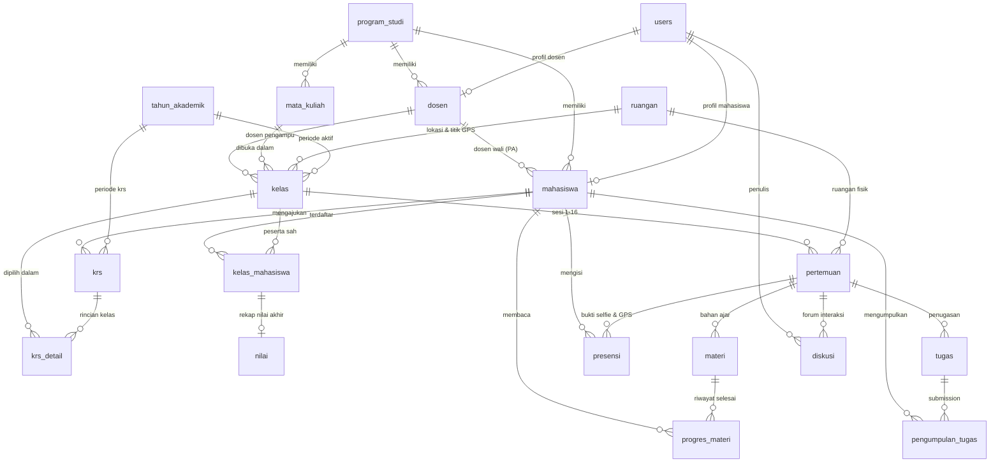

# ENTITY RELATIONSHIP DIAGRAM (ERD) & RELATIONAL SCHEMA

## SIELMA — Sistem Akademik & E-Learning Hybrid Mahasiswa

Dokumen ini mendefinisikan rancangan basis data relasional lengkap (21 tabel) untuk sistem **SIELMA** (*Sistem Akademik & E-Learning Hybrid Mahasiswa*) berbasis Laravel 13 monolith. Rancangan ini mengintegrasikan modul akademik inti (**Master Data, Ruangan GPS, KRS Online, Penjadwalan**) dengan modul LMS (**Pertemuan Offline/Online, Materi Ajar, Presensi Selfie Live & GPS Geofencing, Tugas, Diskusi, serta Nilai Akhir**).

Dokumen pendamping: `01-implementation-plan.md` & `02-prompt.md`.

---

## 1. Diagram ERD Lengkap (Mermaid)



---

## 2. Rincian Entitas & Struktur Tabel (21 Entitas)

### 2.1 Modul Pengguna & Master Akademik

#### 1. `users`
Menyimpan akun autentikasi seluruh pengguna sistem (Admin, Dosen, Mahasiswa).

| Field | Tipe | Key / Index | Nullable | Keterangan |
|---|---|---|---|---|
| `id` | BIGINT UNSIGNED | PK | Tidak | ID User |
| `name` | VARCHAR(255) | | Tidak | Nama lengkap pengguna |
| `email` | VARCHAR(255) | UNIQUE | Tidak | Alamat email unik |
| `password` | VARCHAR(255) | | Tidak | Password terenkripsi (Bcrypt/Argon2) |
| `role` | ENUM('admin','dosen','mahasiswa') | INDEX | Tidak | Peran pengguna (Backed Enum) |
| `remember_token` | VARCHAR(100) | | Ya | Token sesi remember me |
| `created_at` | TIMESTAMP | | Ya | Waktu pembuatan |
| `updated_at` | TIMESTAMP | | Ya | Waktu pembaruan |

#### 2. `program_studi`
Menyimpan data program studi / jurusan institusi.

| Field | Tipe | Key / Index | Nullable | Keterangan |
|---|---|---|---|---|
| `id` | BIGINT UNSIGNED | PK | Tidak | ID Program Studi |
| `kode` | VARCHAR(20) | UNIQUE | Tidak | Kode unik prodi (mis. `TI`, `SI`) |
| `nama` | VARCHAR(255) | | Tidak | Nama program studi |
| `created_at` | TIMESTAMP | | Ya | Waktu pembuatan |
| `updated_at` | TIMESTAMP | | Ya | Waktu pembaruan |
| `deleted_at` | TIMESTAMP | | Ya | Soft delete |

#### 3. `ruangan`
Menyimpan data fisik ruangan perkuliahan yang dilengkapi titik koordinat GPS dan radius geofencing untuk kelas tatap muka (*offline*).

| Field | Tipe | Key / Index | Nullable | Keterangan |
|---|---|---|---|---|
| `id` | BIGINT UNSIGNED | PK | Tidak | ID Ruangan |
| `kode` | VARCHAR(50) | UNIQUE | Tidak | Kode ruangan (mis. `R.301`, `LAB.02`) |
| `nama` | VARCHAR(255) | | Tidak | Nama ruangan lengkap |
| `gedung` | VARCHAR(100) | | Ya | Nama/blok gedung kampus |
| `kapasitas` | SMALLINT UNSIGNED | | Tidak | Kapasitas maksimal kursi |
| `tipe` | ENUM('kelas','lab','auditorium') | | Tidak | Jenis ruangan |
| `latitude` | DECIMAL(10, 7) | | Ya | Titik garis lintang GPS gedung/ruangan |
| `longitude` | DECIMAL(10, 7) | | Ya | Titik garis bujur GPS gedung/ruangan |
| `radius_meter` | SMALLINT UNSIGNED | | Tidak | Batas radius geofencing (default: `100` m) |
| `created_at` | TIMESTAMP | | Ya | Waktu pembuatan |
| `updated_at` | TIMESTAMP | | Ya | Waktu pembaruan |
| `deleted_at` | TIMESTAMP | | Ya | Soft delete |

#### 4. `tahun_akademik`
Menyimpan data kalender akademik, semester berjalan, dan konfigurasi periode KRS.

| Field | Tipe | Key / Index | Nullable | Keterangan |
|---|---|---|---|---|
| `id` | BIGINT UNSIGNED | PK | Tidak | ID Tahun Akademik |
| `tahun` | VARCHAR(20) | INDEX | Tidak | Contoh: `2024/2025` |
| `semester` | ENUM('Ganjil','Genap') | INDEX | Tidak | Semester ganjil/genap |
| `is_active` | BOOLEAN | INDEX | Tidak | Flag semester aktif berjalan (hanya 1 aktif) |
| `is_krs_open` | BOOLEAN | | Tidak | Sakelar buka/tutup masa pengisian KRS |
| `krs_mulai` | DATE | | Ya | Tanggal mulai pengisian KRS |
| `krs_selesai` | DATE | | Ya | Tanggal batas akhir pengisian KRS |
| `maks_sks_default`| SMALLINT UNSIGNED | | Tidak | Batas maksimal SKS standar (default: `24`) |
| `created_at` | TIMESTAMP | | Ya | Waktu pembuatan |
| `updated_at` | TIMESTAMP | | Ya | Waktu pembaruan |

> **Constraint Unik**: `UNIQUE(tahun, semester)`

#### 5. `dosen`
Menyimpan profil dosen pengajar dan dosen wali.

| Field | Tipe | Key / Index | Nullable | Keterangan |
|---|---|---|---|---|
| `id` | BIGINT UNSIGNED | PK | Tidak | ID Dosen |
| `user_id` | BIGINT UNSIGNED | FK, UNIQUE | Tidak | Relasi ke `users.id` |
| `program_studi_id`| BIGINT UNSIGNED | FK | Tidak | Relasi ke `program_studi.id` |
| `nidn` | VARCHAR(30) | UNIQUE | Tidak | NIDN unik dosen |
| `nip` | VARCHAR(50) | Ya, INDEX | Ya | NIP dosen (opsional) |
| `nama` | VARCHAR(255) | | Tidak | Nama dosen beserta gelar |
| `email` | VARCHAR(255) | Ya | Ya | Email korespondensi dosen |
| `created_at` | TIMESTAMP | | Ya | Waktu pembuatan |
| `updated_at` | TIMESTAMP | | Ya | Waktu pembaruan |
| `deleted_at` | TIMESTAMP | | Ya | Soft delete |

#### 6. `mahasiswa`
Menyimpan data induk mahasiswa beserta relasi ke Dosen Wali (Pembimbing Akademik).

| Field | Tipe | Key / Index | Nullable | Keterangan |
|---|---|---|---|---|
| `id` | BIGINT UNSIGNED | PK | Tidak | ID Mahasiswa |
| `user_id` | BIGINT UNSIGNED | FK, UNIQUE | Tidak | Relasi ke `users.id` |
| `program_studi_id`| BIGINT UNSIGNED | FK | Tidak | Relasi ke `program_studi.id` |
| `dosen_wali_id` | BIGINT UNSIGNED | FK, INDEX | Ya | Relasi ke `dosen.id` (Dosen Pembimbing Akademik) |
| `nim` | VARCHAR(30) | UNIQUE | Tidak | Nomor Induk Mahasiswa |
| `nama` | VARCHAR(255) | | Tidak | Nama lengkap mahasiswa |
| `angkatan` | YEAR | INDEX | Tidak | Tahun masuk angkatan (mis. `2024`) |
| `created_at` | TIMESTAMP | | Ya | Waktu pembuatan |
| `updated_at` | TIMESTAMP | | Ya | Waktu pembaruan |
| `deleted_at` | TIMESTAMP | | Ya | Soft delete |

#### 7. `mata_kuliah`
Menyimpan kurikulum mata kuliah per program studi.

| Field | Tipe | Key / Index | Nullable | Keterangan |
|---|---|---|---|---|
| `id` | BIGINT UNSIGNED | PK | Tidak | ID Mata Kuliah |
| `program_studi_id`| BIGINT UNSIGNED | FK | Tidak | Relasi ke `program_studi.id` |
| `kode` | VARCHAR(50) | UNIQUE | Tidak | Kode mata kuliah (mis. `MK101`) |
| `nama` | VARCHAR(255) | | Tidak | Nama mata kuliah |
| `sks` | SMALLINT UNSIGNED | | Tidak | Bobot SKS (mis. 2, 3, 4) |
| `semester_paket` | SMALLINT UNSIGNED | | Tidak | Semester rekomendasi paket (1–8) |
| `created_at` | TIMESTAMP | | Ya | Waktu pembuatan |
| `updated_at` | TIMESTAMP | | Ya | Waktu pembaruan |
| `deleted_at` | TIMESTAMP | | Ya | Soft delete |

---

### 2.2 Modul Penjadwalan & KRS Online

#### 8. `kelas`
Menyimpan rombel kelas perkuliahan, jadwal mingguan, mode pertemuan, dan kuota peserta.

| Field | Tipe | Key / Index | Nullable | Keterangan |
|---|---|---|---|---|
| `id` | BIGINT UNSIGNED | PK | Tidak | ID Kelas |
| `mata_kuliah_id` | BIGINT UNSIGNED | FK | Tidak | Relasi ke `mata_kuliah.id` |
| `dosen_id` | BIGINT UNSIGNED | FK | Tidak | Relasi ke `dosen.id` (Dosen Pengampu) |
| `tahun_akademik_id`| BIGINT UNSIGNED | FK | Tidak | Relasi ke `tahun_akademik.id` |
| `ruangan_id` | BIGINT UNSIGNED | FK | Ya | Relasi ke `ruangan.id` (nullable bila daring penuh) |
| `nama_kelas` | VARCHAR(50) | | Tidak | Nama rombel (mis. `TI-3A`, `SI-1B`) |
| `tipe_kelas` | ENUM('offline','online','hybrid') | | Tidak | Tipe pelaksanaan kelas perkuliahan |
| `hari` | ENUM('Senin','Selasa','Rabu','Kamis','Jumat','Sabtu') | INDEX | Tidak | Hari perkuliahan |
| `jam_mulai` | TIME | INDEX | Tidak | Waktu mulai kelas (mis. `08:00:00`) |
| `jam_selesai` | TIME | INDEX | Tidak | Waktu selesai kelas (mis. `10:30:00`) |
| `kapasitas` | SMALLINT UNSIGNED | | Tidak | Kuota maksimal mahasiswa dalam kelas |
| `created_at` | TIMESTAMP | | Ya | Waktu pembuatan |
| `updated_at` | TIMESTAMP | | Ya | Waktu pembaruan |

> **Constraint Unik**: `UNIQUE(mata_kuliah_id, tahun_akademik_id, nama_kelas)`

#### 9. `krs`
Menyimpan pengajuan Kartu Rencana Studi (KRS) mahasiswa per semester akademik beserta status perwalian.

| Field | Tipe | Key / Index | Nullable | Keterangan |
|---|---|---|---|---|
| `id` | BIGINT UNSIGNED | PK | Tidak | ID KRS |
| `mahasiswa_id` | BIGINT UNSIGNED | FK | Tidak | Relasi ke `mahasiswa.id` |
| `tahun_akademik_id`| BIGINT UNSIGNED | FK | Tidak | Relasi ke `tahun_akademik.id` |
| `total_sks` | SMALLINT UNSIGNED | | Tidak | Akumulasi total SKS yang diajukan |
| `status` | ENUM('draft','diajukan','revisi','disetujui') | INDEX | Tidak | Status alur perwalian KRS |
| `catatan_wali` | TEXT | | Ya | Catatan bimbingan dari Dosen Wali |
| `disetujui_oleh` | BIGINT UNSIGNED | FK | Ya | Relasi ke `users.id` (Dosen Wali / Admin) |
| `disetujui_pada` | TIMESTAMP | | Ya | Waktu persetujuan resmi |
| `created_at` | TIMESTAMP | | Ya | Waktu pembuatan |
| `updated_at` | TIMESTAMP | | Ya | Waktu pembaruan |

> **Constraint Unik**: `UNIQUE(mahasiswa_id, tahun_akademik_id)`

#### 10. `krs_detail`
Rincian daftar kelas yang dipilih oleh mahasiswa dalam satu dokumen KRS.

| Field | Tipe | Key / Index | Nullable | Keterangan |
|---|---|---|---|---|
| `id` | BIGINT UNSIGNED | PK | Tidak | ID KRS Detail |
| `krs_id` | BIGINT UNSIGNED | FK | Tidak | Relasi ke `krs.id` (Cascade on Delete) |
| `kelas_id` | BIGINT UNSIGNED | FK | Tidak | Relasi ke `kelas.id` (Restrict on Delete) |
| `created_at` | TIMESTAMP | | Ya | Waktu pembuatan |
| `updated_at` | TIMESTAMP | | Ya | Waktu pembaruan |

> **Constraint Unik**: `UNIQUE(krs_id, kelas_id)`

#### 11. `kelas_mahasiswa`
Tabel peserta kelas sah. Data baru masuk ke tabel ini setelah KRS mahasiswa dinyatakan **Disetujui** oleh Dosen Wali atau di-override Admin.

| Field | Tipe | Key / Index | Nullable | Keterangan |
|---|---|---|---|---|
| `id` | BIGINT UNSIGNED | PK | Tidak | ID Peserta Kelas |
| `kelas_id` | BIGINT UNSIGNED | FK | Tidak | Relasi ke `kelas.id` |
| `mahasiswa_id` | BIGINT UNSIGNED | FK | Tidak | Relasi ke `mahasiswa.id` |
| `krs_id` | BIGINT UNSIGNED | FK | Ya | Relasi sumber ke `krs.id` |
| `created_at` | TIMESTAMP | | Ya | Waktu pembuatan |
| `updated_at` | TIMESTAMP | | Ya | Waktu pembaruan |

> **Constraint Unik**: `UNIQUE(kelas_id, mahasiswa_id)`

---

### 2.3 Modul LMS Perkuliahan & Presensi Geofencing

#### 12. `pertemuan`
Menyimpan sesi perkuliahan (Sesi 1–16) per kelas, pengaturan presensi selfie/GPS, dan Berita Acara Perkuliahan (BAP).

| Field | Tipe | Key / Index | Nullable | Keterangan |
|---|---|---|---|---|
| `id` | BIGINT UNSIGNED | PK | Tidak | ID Pertemuan |
| `kelas_id` | BIGINT UNSIGNED | FK | Tidak | Relasi ke `kelas.id` |
| `pertemuan_ke` | SMALLINT UNSIGNED | | Tidak | Urutan sesi pertemuan (1–16) |
| `judul` | VARCHAR(255) | | Tidak | Topik materi pokok bahasan |
| `mode` | ENUM('offline','online') | | Tidak | Tatap Muka fisik atau Daring |
| `ruangan_id` | BIGINT UNSIGNED | FK | Ya | Relasi ke `ruangan.id` (lokasi GPS acuan) |
| `tautan_meeting` | VARCHAR(255) | | Ya | URL Zoom/Google Meet bila online |
| `tanggal` | DATE | INDEX | Tidak | Tanggal pelaksanaan kelas |
| `berita_acara` | TEXT | | Ya | Catatan BAP capaian materi dosen |
| `is_published` | BOOLEAN | | Tidak | Status tayang materi ke mahasiswa |
| `is_presensi_open`| BOOLEAN | | Tidak | Sakelar buka/tutup sesi absensi |
| `wajib_selfie` | BOOLEAN | | Tidak | Wajib menyertakan foto kamera live (default: `true`) |
| `wajib_gps` | BOOLEAN | | Tidak | Wajib validasi geofencing GPS (default: `true`) |
| `kode_presensi` | VARCHAR(10) | | Ya | Kode PIN 6 digit sesi (opsional kelas offline) |
| `created_at` | TIMESTAMP | | Ya | Waktu pembuatan |
| `updated_at` | TIMESTAMP | | Ya | Waktu pembaruan |

> **Constraint Unik**: `UNIQUE(kelas_id, pertemuan_ke)`

#### 13. `materi`
Menyimpan materi ajar per sesi pertemuan (dokumen PDF/PPTX, link artikel, atau video).

| Field | Tipe | Key / Index | Nullable | Keterangan |
|---|---|---|---|---|
| `id` | BIGINT UNSIGNED | PK | Tidak | ID Materi |
| `pertemuan_id` | BIGINT UNSIGNED | FK | Tidak | Relasi ke `pertemuan.id` (Cascade on Delete) |
| `judul` | VARCHAR(255) | | Tidak | Judul materi ajar |
| `tipe` | ENUM('file','link','video') | | Tidak | Format konten materi |
| `konten_atau_url` | TEXT | | Ya | Isi teks ringkas atau URL eksternal |
| `file_path` | VARCHAR(255) | | Ya | Path file di disk `private` (jika upload file) |
| `urutan` | SMALLINT UNSIGNED | | Tidak | Urutan tayang materi dalam sesi |
| `created_at` | TIMESTAMP | | Ya | Waktu pembuatan |
| `updated_at` | TIMESTAMP | | Ya | Waktu pembaruan |

#### 14. `progres_materi`
Mencatat riwayat mahasiswa yang telah membaca atau menyelesaikan materi pembelajaran.

| Field | Tipe | Key / Index | Nullable | Keterangan |
|---|---|---|---|---|
| `id` | BIGINT UNSIGNED | PK | Tidak | ID Progres |
| `materi_id` | BIGINT UNSIGNED | FK | Tidak | Relasi ke `materi.id` (Cascade on Delete) |
| `mahasiswa_id` | BIGINT UNSIGNED | FK | Tidak | Relasi ke `mahasiswa.id` (Cascade on Delete) |
| `selesai_pada` | TIMESTAMP | | Tidak | Waktu mahasiswa menandai selesai |
| `created_at` | TIMESTAMP | | Ya | Waktu pembuatan |
| `updated_at` | TIMESTAMP | | Ya | Waktu pembaruan |

> **Constraint Unik**: `UNIQUE(materi_id, mahasiswa_id)`

#### 15. `presensi`
Mencatat kehadiran mahasiswa dengan bukti swafoto kamera live, koordinat GPS geofencing, dan hasil kalkulasi rumus Haversine.

| Field | Tipe | Key / Index | Nullable | Keterangan |
|---|---|---|---|---|
| `id` | BIGINT UNSIGNED | PK | Tidak | ID Presensi |
| `pertemuan_id` | BIGINT UNSIGNED | FK | Tidak | Relasi ke `pertemuan.id` |
| `mahasiswa_id` | BIGINT UNSIGNED | FK, INDEX | Tidak | Relasi ke `mahasiswa.id` |
| `status` | ENUM('hadir','izin','sakit','alpha') | INDEX | Tidak | Status kehadiran |
| `foto_selfie_path`| VARCHAR(255) | | Ya | Path file foto di disk `private` |
| `latitude` | DECIMAL(10, 7) | | Ya | Titik latitude GPS mahasiswa saat submit |
| `longitude` | DECIMAL(10, 7) | | Ya | Titik longitude GPS mahasiswa saat submit |
| `akurasi_meter` | DECIMAL(8, 2) | | Ya | Estimasi akurasi sinyal GPS perangkat (meter) |
| `jarak_meter` | DECIMAL(8, 2) | | Ya | Jarak Haversine ke ruangan kelas (meter) |
| `is_dalam_radius` | BOOLEAN | | Tidak | `true` bila jarak <= radius ruangan |
| `metode` | ENUM('mandiri','manual_dosen') | | Tidak | Sumber pencatatan kehadiran |
| `ip_address` | VARCHAR(45) | | Ya | Alamat IP perangkat mahasiswa |
| `user_agent` | TEXT | | Ya | Identitas browser/perangkat |
| `keterangan` | TEXT | | Ya | Alasan izin/sakit atau catatan dosen |
| `dicatat_pada` | TIMESTAMP | | Tidak | Waktu persis presensi direkam |
| `created_at` | TIMESTAMP | | Ya | Waktu pembuatan |
| `updated_at` | TIMESTAMP | | Ya | Waktu pembaruan |

> **Constraint Unik**: `UNIQUE(pertemuan_id, mahasiswa_id)`

---

### 2.4 Modul Tugas & Forum Diskusi

#### 16. `tugas`
Menyimpan penugasan berbatas waktu (*deadline*) per pertemuan.

| Field | Tipe | Key / Index | Nullable | Keterangan |
|---|---|---|---|---|
| `id` | BIGINT UNSIGNED | PK | Tidak | ID Tugas |
| `pertemuan_id` | BIGINT UNSIGNED | FK | Tidak | Relasi ke `pertemuan.id` (Cascade on Delete) |
| `judul` | VARCHAR(255) | | Tidak | Judul penugasan |
| `instruksi` | TEXT | | Tidak | Deskripsi dan petunjuk pengerjaan |
| `lampiran_path` | VARCHAR(255) | | Ya | File template/soal di disk `private` |
| `batas_waktu` | DATETIME | INDEX | Tidak | Tenggat waktu pengumpulan (deadline) |
| `allow_late` | BOOLEAN | | Tidak | Bolehkah mengumpulkan setelah deadline |
| `created_at` | TIMESTAMP | | Ya | Waktu pembuatan |
| `updated_at` | TIMESTAMP | | Ya | Waktu pembaruan |

#### 17. `pengumpulan_tugas`
Menyimpan lembar jawaban mahasiswa (*submission*) beserta skor nilai dan umpan balik dosen.

| Field | Tipe | Key / Index | Nullable | Keterangan |
|---|---|---|---|---|
| `id` | BIGINT UNSIGNED | PK | Tidak | ID Pengumpulan |
| `tugas_id` | BIGINT UNSIGNED | FK | Tidak | Relasi ke `tugas.id` (Cascade on Delete) |
| `mahasiswa_id` | BIGINT UNSIGNED | FK, INDEX | Tidak | Relasi ke `mahasiswa.id` |
| `file_path` | VARCHAR(255) | | Tidak | File jawaban di disk `private` |
| `catatan_mahasiswa`| TEXT | | Ya | Catatan pengantar mahasiswa |
| `dikumpulkan_pada`| DATETIME | | Tidak | Waktu pengunggahan berkas |
| `is_terlambat` | BOOLEAN | | Tidak | Flag apakah lewat dari `batas_waktu` |
| `nilai` | DECIMAL(5, 2) | | Ya | Skor penilaian dosen (skala 0–100) |
| `umpan_balik` | TEXT | | Ya | Catatan koreksi/evaluasi dari dosen |
| `created_at` | TIMESTAMP | | Ya | Waktu pembuatan |
| `updated_at` | TIMESTAMP | | Ya | Waktu pembaruan |

> **Constraint Unik**: `UNIQUE(tugas_id, mahasiswa_id)`

#### 18. `diskusi`
Forum interaksi dan tanya jawab komentar bertingkat per pertemuan.

| Field | Tipe | Key / Index | Nullable | Keterangan |
|---|---|---|---|---|
| `id` | BIGINT UNSIGNED | PK | Tidak | ID Komentar |
| `pertemuan_id` | BIGINT UNSIGNED | FK | Tidak | Relasi ke `pertemuan.id` (Cascade on Delete) |
| `user_id` | BIGINT UNSIGNED | FK | Tidak | Relasi ke `users.id` (penulis komentar) |
| `parent_id` | BIGINT UNSIGNED | FK | Ya | Relasi ke `diskusi.id` (untuk reply thread) |
| `isi` | TEXT | | Tidak | Konten pesan diskusi |
| `created_at` | TIMESTAMP | INDEX | Ya | Waktu pembuatan |
| `updated_at` | TIMESTAMP | | Ya | Waktu pembaruan |

---

### 2.5 Modul Evaluasi & Nilai Akhir

#### 19. `nilai`
Menyimpan rekapitulasi evaluasi nilai mahasiswa per kelas (1:1 terhadap `kelas_mahasiswa`), hasil hitung nilai akhir, grade, dan status kelulusan.

| Field | Tipe | Key / Index | Nullable | Keterangan |
|---|---|---|---|---|
| `id` | BIGINT UNSIGNED | PK | Tidak | ID Nilai |
| `kelas_mahasiswa_id`| BIGINT UNSIGNED | FK, UNIQUE | Tidak | Relasi 1:1 ke `kelas_mahasiswa.id` |
| `kuis` | DECIMAL(5, 2) | | Ya | Nilai Kuis (0–100) |
| `tugas` | DECIMAL(5, 2) | | Ya | Nilai Tugas (bisa ditarik dari rata-rata LMS) |
| `uts` | DECIMAL(5, 2) | | Ya | Nilai UTS (0–100) |
| `uas` | DECIMAL(5, 2) | | Ya | Nilai UAS (0–100) |
| `nilai_akhir` | DECIMAL(5, 2) | | Ya | Hasil perhitungan bobot (0–100) |
| `grade` | VARCHAR(5) | INDEX | Ya | Grade huruf: `A`, `B`, `C`, `D`, `E` |
| `status` | ENUM('lulus','tidak_lulus','belum_lengkap')| INDEX | Tidak | Status kelulusan mata kuliah |
| `updated_by` | BIGINT UNSIGNED | FK | Ya | Relasi ke `users.id` (Dosen/Admin pengubah) |
| `created_at` | TIMESTAMP | | Ya | Waktu pembuatan |
| `updated_at` | TIMESTAMP | | Ya | Waktu pembaruan |

#### 20. `pengaturan_nilai`
Konfigurasi bobot persentase komponen penilaian yang berlaku di institusi (total bobot wajib 100%).

| Field | Tipe | Key / Index | Nullable | Keterangan |
|---|---|---|---|---|
| `id` | BIGINT UNSIGNED | PK | Tidak | ID Pengaturan |
| `komponen` | ENUM('kuis','tugas','uts','uas') | UNIQUE | Tidak | Nama komponen evaluasi |
| `bobot` | DECIMAL(5, 2) | | Tidak | Persentase bobot (mis. 10, 20, 30, 40) |
| `created_at` | TIMESTAMP | | Ya | Waktu pembuatan |
| `updated_at` | TIMESTAMP | | Ya | Waktu pembaruan |

#### 21. `skala_grade`
Tabel patokan rentang nilai minimum untuk penentuan huruf mutu (grade) dan status kelulusan.

| Field | Tipe | Key / Index | Nullable | Keterangan |
|---|---|---|---|---|
| `id` | BIGINT UNSIGNED | PK | Tidak | ID Skala |
| `grade` | VARCHAR(5) | UNIQUE | Tidak | Huruf grade: `A`, `B`, `C`, `D`, `E` |
| `nilai_min` | DECIMAL(5, 2) | | Tidak | Batas nilai minimal (mis. 80, 70, 60, 50, 0) |
| `is_lulus` | BOOLEAN | | Tidak | `true` jika grade memenuhi syarat lulus |
| `urutan` | SMALLINT UNSIGNED | | Tidak | Urutan prioritas evaluasi (1 = tertinggi) |
| `created_at` | TIMESTAMP | | Ya | Waktu pembuatan |
| `updated_at` | TIMESTAMP | | Ya | Waktu pembaruan |

---

## 3. Relational Schema & Foreign Keys

```text
users (id)
  ▲
  ├─── dosen (user_id)
  ├─── mahasiswa (user_id)
  ├─── krs (disetujui_oleh)
  ├─── diskusi (user_id)
  └─── nilai (updated_by)

program_studi (id)
  ▲
  ├─── dosen (program_studi_id)
  ├─── mahasiswa (program_studi_id)
  └─── mata_kuliah (program_studi_id)

dosen (id)
  ▲
  ├─── mahasiswa (dosen_wali_id)
  └─── kelas (dosen_id)

ruangan (id)
  ▲
  ├─── kelas (ruangan_id)
  └─── pertemuan (ruangan_id)

tahun_akademik (id)
  ▲
  ├─── kelas (tahun_akademik_id)
  └─── krs (tahun_akademik_id)

mata_kuliah (id)
  ▲
  └─── kelas (mata_kuliah_id)

krs (id)
  ▲
  ├─── krs_detail (krs_id) [Cascade]
  └─── kelas_mahasiswa (krs_id) [Set Null]

kelas (id)
  ▲
  ├─── krs_detail (kelas_id) [Restrict]
  ├─── kelas_mahasiswa (kelas_id) [Restrict]
  └─── pertemuan (kelas_id) [Cascade]

mahasiswa (id)
  ▲
  ├─── krs (mahasiswa_id) [Restrict]
  ├─── kelas_mahasiswa (mahasiswa_id) [Restrict]
  ├─── progres_materi (mahasiswa_id) [Cascade]
  ├─── presensi (mahasiswa_id) [Restrict]
  └─── pengumpulan_tugas (mahasiswa_id) [Restrict]

kelas_mahasiswa (id)
  ▲
  └─── nilai (kelas_mahasiswa_id) [Cascade]

pertemuan (id)
  ▲
  ├─── materi (pertemuan_id) [Cascade]
  ├─── presensi (pertemuan_id) [Cascade]
  ├─── tugas (pertemuan_id) [Cascade]
  └─── diskusi (pertemuan_id) [Cascade]

materi (id)
  ▲
  └─── progres_materi (materi_id) [Cascade]

tugas (id)
  ▲
  └─── pengumpulan_tugas (tugas_id) [Cascade]

diskusi (id)
  ▲
  └─── diskusi (parent_id) [Cascade]
```

---

## 4. Aturan Integritas, Constraint & Indexing

### 4.1 Constraint Unik Kritis
1. `UNIQUE(tahun_akademik: tahun, semester)`: Mencegah duplikasi nama tahun akademik dan semester.
2. `UNIQUE(kelas: mata_kuliah_id, tahun_akademik_id, nama_kelas)`: Mencegah rombel kelas ganda untuk mata kuliah yang sama di satu semester.
3. `UNIQUE(krs: mahasiswa_id, tahun_akademik_id)`: Satu mahasiswa hanya memiliki tepat 1 dokumen KRS per semester akademik.
4. `UNIQUE(krs_detail: krs_id, kelas_id)`: Mencegah mahasiswa memilih kelas yang sama dua kali dalam satu pengajuan KRS.
5. `UNIQUE(kelas_mahasiswa: kelas_id, mahasiswa_id)`: Mahasiswa hanya dapat terdaftar 1 kali sebagai peserta sah di sebuah kelas.
6. `UNIQUE(pertemuan: kelas_id, pertemuan_ke)`: Mencegah nomor sesi pertemuan ganda (misal dua kali Sesi 3) pada kelas yang sama.
7. `UNIQUE(presensi: pertemuan_id, mahasiswa_id)`: Mahasiswa hanya memiliki tepat 1 rekaman presensi per pertemuan.
8. `UNIQUE(progres_materi: materi_id, mahasiswa_id)`: Penanda selesai belajar bersifat idempoten per mahasiswa.
9. `UNIQUE(pengumpulan_tugas: tugas_id, mahasiswa_id)`: Pengumpulan tugas menggantikan berkas lama (*re-upload*) atau dibatasi 1 submission aktif.
10. `UNIQUE(nilai: kelas_mahasiswa_id)`: Relasi 1:1 mutlak antara peserta kelas dan lembar nilai akademiknya.

### 4.2 Strategi Indexing untuk Optimasi Query & Laporan
- **Foreign Keys**: Seluruh kolom FK diindeks otomatis oleh MySQL InnoDB (`program_studi_id`, `dosen_id`, `ruangan_id`, `mahasiswa_id`, dll).
- **Deteksi Bentrok Jadwal**: Indeks komposit pada tabel `kelas(hari, jam_mulai, jam_selesai)`.
- **Filter Laporan & Dashboard**:
  - `users(role)`
  - `mahasiswa(angkatan, dosen_wali_id)`
  - `tahun_akademik(is_active)`
  - `krs(status)`
  - `presensi(status, dicatat_pada)`
  - `tugas(batas_waktu)`
  - `nilai(grade, status)`

---

## 5. Alur Data Transaksional Sistem

```text
[1. PENGISIAN KRS ONLINE]
Mahasiswa memilih Kelas -> Validasi KrsService (Batas SKS, Kuota DB lockForUpdate, Anti-Bentrok Jadwal)
         │
         ▼
[2. PERWALIAN KRS]
Dosen Wali mereview pengajuan -> Status 'Disetujui'
         │
         ├──────────────────────────────────────────┐
         ▼                                          ▼
Sinkronkan ke 'kelas_mahasiswa'          Inisialisasi baris 'nilai'
         │                                          │
         ▼                                          │
[3. PERKULIAHAN & LMS HYBRID]                      │
Dosen membuka Sesi 1–16 di 'pertemuan'              │
         │                                          │
         ├───────────────────────────────┐          │
         ▼                               ▼          │
Presensi Selfie & GPS              Tugas E-Learning │
(Validasi Radius Haversine)       (Nilai 0–100)     │
         │                               │          │
         ▼                               ▼          │
Galeri Verifikasi Dosen           Sinkronisasi Rata2│
(Status Hadir/Izin/Sakit/Alpha)   Nilai Tugas ke ───┘
                                                    │
                                                    ▼
                                         [4. REKAPITULASI NILAI AKHIR]
                                         Input Kuis, UTS, UAS Massal
                                                    │
                                                    ▼
                                         Kalkulasi NilaiCalculator:
                                         Nilai Akhir -> Grade -> Status
                                                    │
                                                    ▼
                                         [5. LAPORAN & CETAK DOKUMEN]
                                         - Cetak Lembar KRS (PDF)
                                         - Rekap Daftar Hadir (PDF/Excel)
                                         - Kartu Hasil Studi / KHS (PDF/Excel)
```

---

## 6. Catatan Keamanan, Privasi & Geofencing

1. **Privasi Foto Swafoto (UU PDP)**:
   - Kolom `presensi.foto_selfie_path`, `tugas.lampiran_path`, dan `pengumpulan_tugas.file_path` merujuk ke direktori `storage/app/private/`.
   - Berkas **dilarang keras** disajikan lewat tautan publik (`public/storage`). Akses file wajib melewati controller otorisasi (mis. `FotoPresensiController` dan `UnduhFileController`) yang memvalidasi hak akses melalui Policy.
2. **Kalkulasi Geofencing Server-Side**:
   - Nilai kolom `presensi.jarak_meter` dan flag `presensi.is_dalam_radius` **selalu dihitung ulang di server** menggunakan rumus Haversine berdasarkan koordinat `ruangan.latitude` & `ruangan.longitude`. Data kalkulasi jarak dari JavaScript klien diabaikan untuk mencegah pemalsuan (*spoofing*).
3. **Pemberian Skor & Sinkronisasi**:
   - Kolom `nilai.tugas` dapat diisi manual oleh dosen pengampu atau diperbarui secara otomatis menggunakan service `SinkronisasiTugasService` yang mengambil rata-rata nilai dari tabel `pengumpulan_tugas`.
